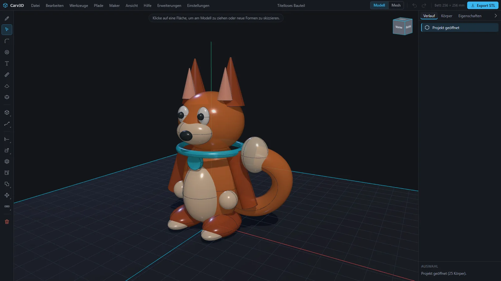
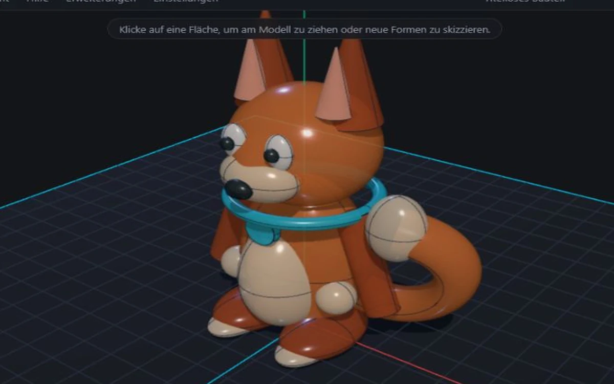
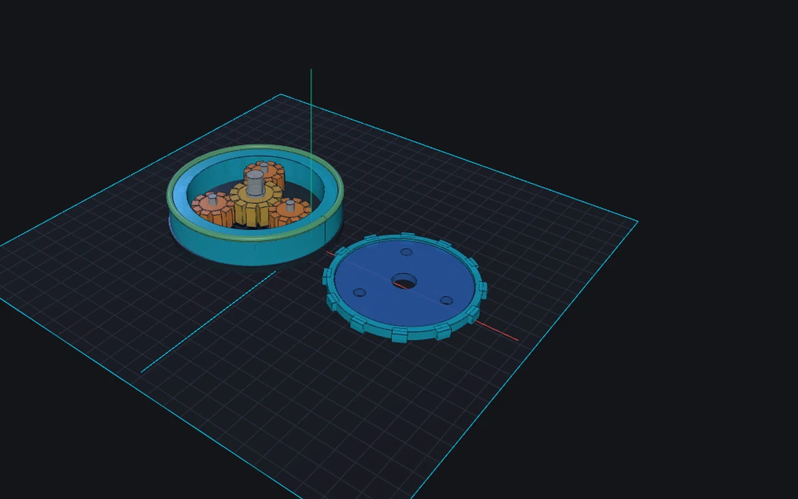
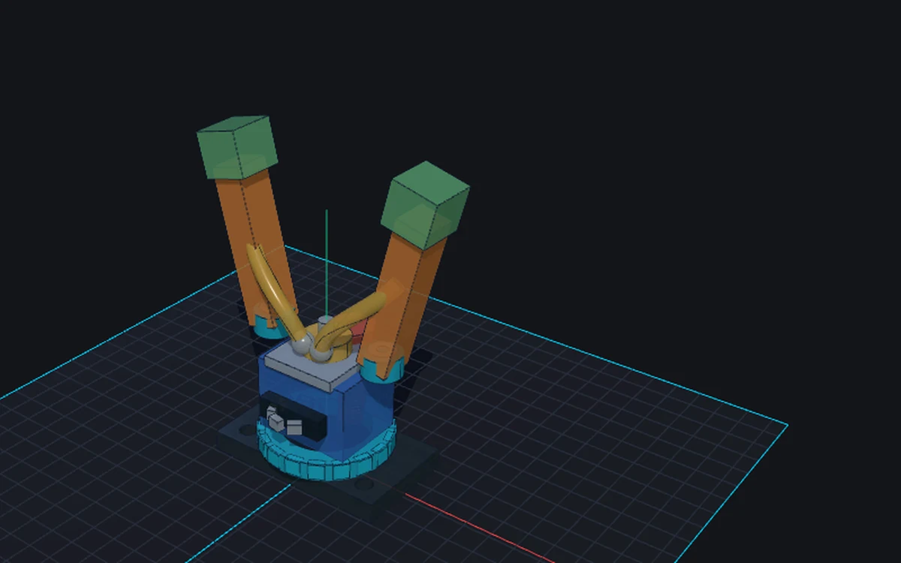
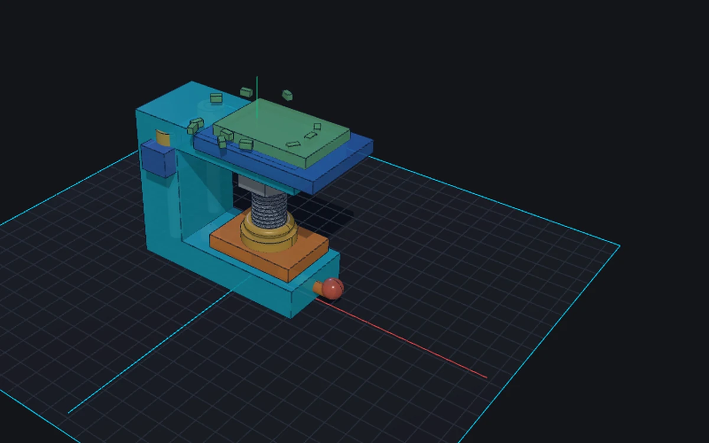
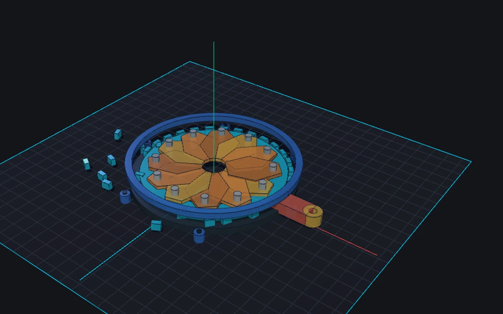
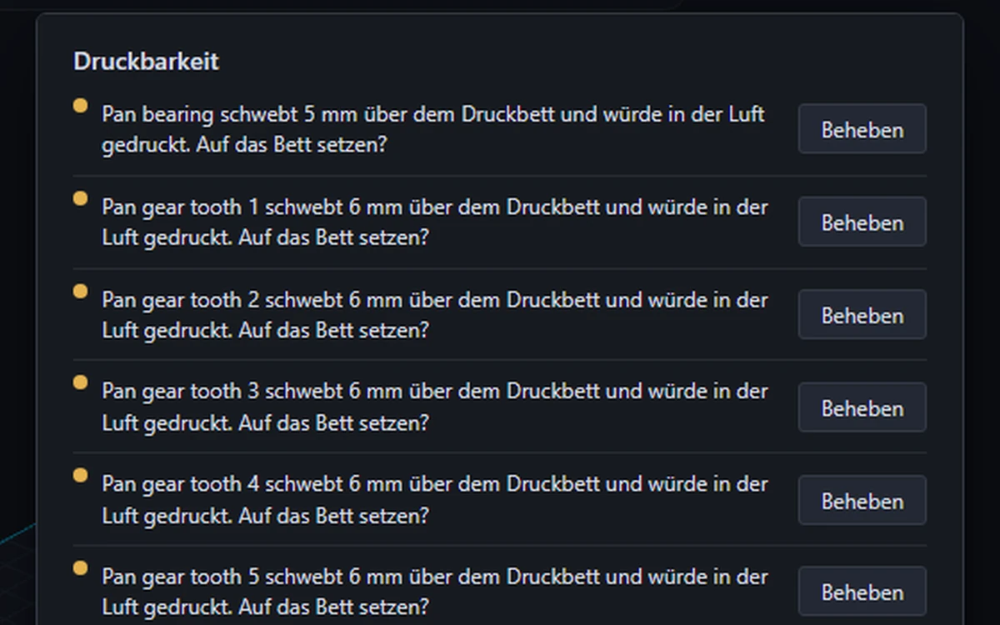
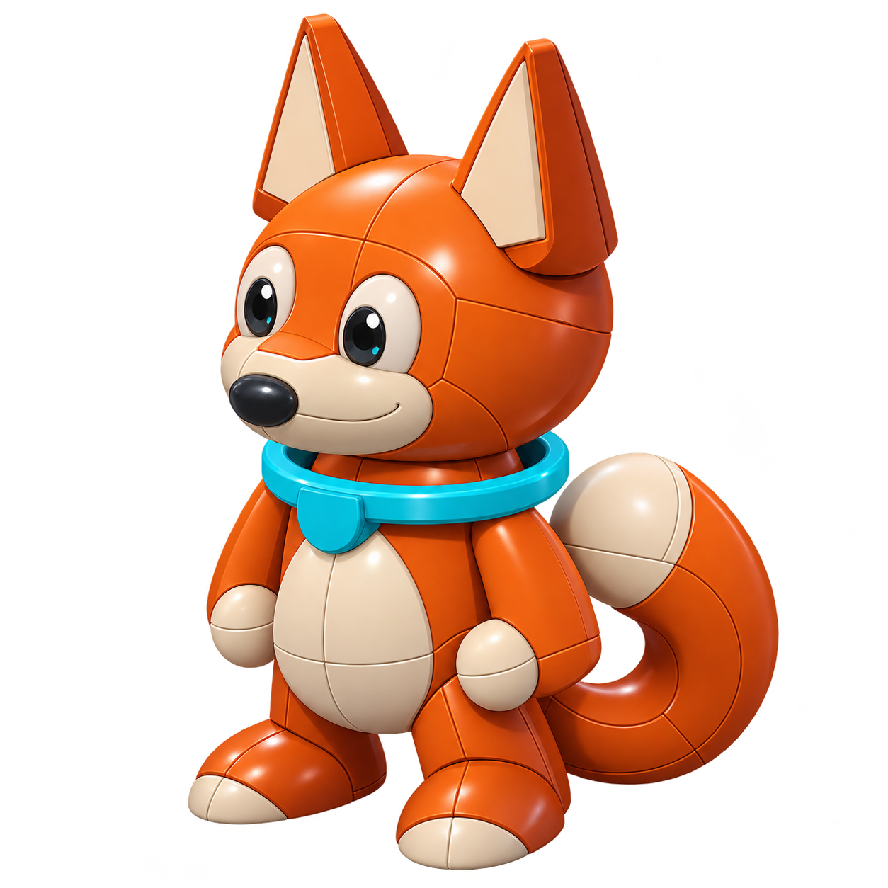

  

# Carv3D

**English** · [Deutsch](README.de.md)

  

  <strong>Direct CAD for 3D printing and maker projects.</strong> 
  Precise solid modeling, organic mesh sculpting, practical hardware tools and print checks in one focused workspace.

  <a href="https://carv3d.de/Beta.html">Website</a> ·
  <a href="https://carv3d.de/Beta.html#beta"><strong>Apply for the private beta</strong></a> ·
  <a href="docs/USER_MANUAL.md">User manual</a> ·
  <a href="docs/CAPABILITIES.md">Current capabilities</a>

> [!IMPORTANT]
> Carv3D is a **closed-source application currently in private early beta**. This public repository contains product information, documentation, issue templates and the public roadmap. It does not contain the application core or a public download.

Carv3D is developed and maintained by **[Carv3D Studio](https://github.com/Carv3D-Studio)**. The public repository and the private application core live in the same organization while remaining clearly separated.

## Built for parts that need to work

Carv3D combines direct editing of true solid bodies with tools aimed at real workshop and printing tasks. Select a face or edge, change it directly, enter an exact value and keep working without building a long feature tree.

| Model | Build | Print |
| --- | --- | --- |
| Push/pull faces, edit edges and vertices, fillet, chamfer, shell, draft, align, mirror and pattern | Persistent sketches, revolve, sweep, loft, paths, springs, booleans and construction planes | Wall, overhang, bridge and build-volume checks; orientation guidance, layer preview and material estimates |
| True B-Rep solids for precise parts | Mesh sculpting with Grab, Inflate, Pinch, Flatten, Smooth, symmetry and local refinement | Split parts with alignment pins and export to STL, 3MF or STEP |
| STEP, STL, OBJ, 3MF, DXF and SVG import workflows | Real internal and external ISO threads, holes, inserts, nut traps, magnets and hardware placeholders | Printer profiles with nozzle, layer height, material shrinkage and fit tolerances |

[See the current capability overview →](docs/CAPABILITIES.md)

## Made in Carv3D

The examples below are editable Carv3D projects shown on the application's baseplate. They combine solid operations, mesh modeling, threads, paths, patterns and mechanical assemblies.

| Organic and mechanical | Mechanisms and joints |
| --- | --- |
|  **Maker Fox** — a 25-body character combining a sculpted head, swept tail and dimensioned solid details. |  **Planetary drive** — ring gear, sun, three planets, bearings and an exploded carrier across 92 bodies. |
|  **Robot gripper** — synchronized links, pivot bearings, replaceable jaws and a threaded center stop. |  **Precision desk clamp** — a one-piece C-frame, M16 spindle, guide rails, thrust bearing and sliding handle. |
|  **Mechanical iris** — twelve overlapping blades, individual pivots, an actuator gear and mounting bezel. |  **Printability analysis** — thin walls, bridges, overhangs and build-volume problems are checked before export. |

More examples and short videos are available on the [Carv3D website](https://carv3d.de/Beta.html#showcase).

## Local AI through MCP

Carv3D exposes its modeling commands through a local **Model Context Protocol (MCP)** server. MCP-capable local agents can create, inspect, modify, measure, check and export models through the same command layer used by the interface.

- no model-provider API key is entered into Carv3D
- the geometry and project stay on the local machine
- a headless mode can build models without an open browser
- a live bridge can operate the open Carv3D workspace
- designed for MCP-capable agents such as OpenAI Codex, Claude and Google Gemini

Product names belong to their respective owners; compatibility does not imply endorsement.

## Private early beta

Carv3D is currently tested in small invitation waves. The beta is free, but there is no public test download.

1. [Open the beta application](https://carv3d.de/Beta.html#beta).
2. Describe what you want to build and how you use 3D printing or maker tools.
3. You receive an email receipt immediately. Selected testers receive a separate personal invitation.

The current beta plan allows modeling through **31 March 2027**. After a beta build expires, existing projects remain openable, saveable and exportable as STEP, STL or 3MF. Editing continues with a current beta or a licensed release.

## Product direction

- application core remains closed source
- local modeling without a mandatory account or cloud service
- perpetual license planned for version 1.0; no subscription planned
- current target: about **€49** regular, free educational use for verified teachers and **€10–15** for students
- reviewed community extensions are planned to use visible source code and remain free of charge

Prices, supported platforms and license terms remain planning targets until the stable release. See [Pricing principles](PRICING.md), [Public roadmap](ROADMAP.md) and [Extensions](docs/EXTENSIONS.md).

## Documentation and feedback

- [User manual](docs/USER_MANUAL.md)
- [Current capabilities](docs/CAPABILITIES.md)
- [Beta testing guide](docs/BETA_TESTING.md)
- [Known limitations](docs/KNOWN_LIMITATIONS.md)
- [Public roadmap](ROADMAP.md)
- [Report a bug](https://github.com/Carv3D-Studio/Carv3D/issues/new?template=bug_report.yml)
- [Request a feature](https://github.com/Carv3D-Studio/Carv3D/issues/new?template=feature_request.yml)
- [Security reporting](SECURITY.md)

## Repository and license

This repository is the public information and feedback hub for Carv3D. The proprietary application source, private builds, signing material, tester data and internal development documents are intentionally kept outside it. The public repository contents are covered by [LICENSE](LICENSE).

   
  <strong>Maker Fox</strong> · Carv3D Studio mascot

© 2026 Carv3D Studio
