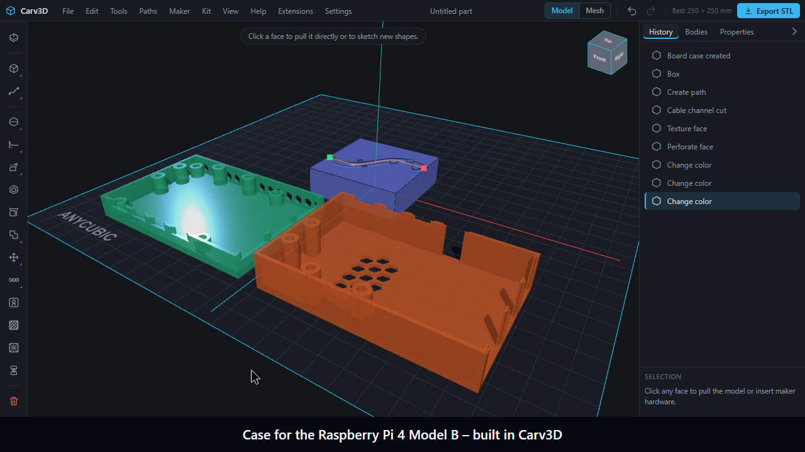

  

# Carv3D

**Developed for 3D printing.** A direct modeler for parts that have to work.

**English** · [Deutsch](README.de.md)

   
  Runs in your browser, no download, no account · <a href="https://carv3d.de/Beta.html#beta">Apply for the private beta</a> · <a href="docs/USER_MANUAL.md">User manual</a>

## Built for parts that need to work

Carv3D combines direct editing of true solid bodies with tools aimed at real workshop and printing tasks. Select a face or edge, change it directly, enter an exact value and keep working without building a long feature tree.

| Model | Build | Print |
| --- | --- | --- |
| Push/pull faces, edit edges and vertices, fillet, chamfer, shell, draft, align, mirror and pattern | Persistent sketches, revolve, sweep, loft, paths, springs, booleans and construction planes | Wall, overhang, bridge and build-volume checks; orientation guidance, layer preview and material estimates |
| True B-Rep solids for precise parts | Mesh sculpting with Grab, Inflate, Pinch, Flatten, Smooth, symmetry and local refinement | Split parts with alignment pins and export to STL, 3MF or STEP |
| STEP, STL, OBJ, 3MF, DXF and SVG import workflows | Real internal and external ISO threads, holes, inserts, nut traps, magnets and hardware placeholders | Printer profiles with nozzle, layer height, material shrinkage and fit tolerances |

[See the current capability overview →](docs/CAPABILITIES.md)

## Watch the film

A Raspberry Pi 4 Model B case in about two minutes, partly in time-lapse, recorded in the real application with subtitles: the case generator with vents, a cable channel with strain relief, knurling and a perforated wall, the part preview on the selected printer's build plate and the 3MF export.

[Watch the English film](docs/media/carv3d-pi-case.en.webm) · [German version](docs/media/carv3d-pi-case.de.webm)

**Try it yourself:** the restricted [live demo](https://carv3d-studio.github.io/Carv3D/) runs in your browser, with no download and no account. Saving, opening, importing and exporting are disabled there, and nothing is stored; see the [demo terms](docs/DEMO_TERMS.md) and the [privacy notice](docs/DEMO_PRIVACY.md).

Download: [English (WebM)](docs/media/carv3d-pi-case.en.webm) · [German (WebM)](docs/media/carv3d-pi-case.de.webm) · [Subtitles (WebVTT)](docs/media/carv3d-pi-case.en.vtt) · [Example model (3MF)](docs/media/carv3d-pi-case-example.3mf)

  

  <strong>Direct modeling for 3D printing.</strong> 
  Pull faces instead of maintaining a feature tree. Exact solids, real threads, hardware pockets, colours per face and print checks in one workspace that runs in your browser.

  <a href="https://carv3d.de/Beta.html">Website</a> ·
  <a href="https://carv3d.de/Beta.html#beta"><strong>Apply for the private beta</strong></a> ·
  <a href="docs/USER_MANUAL.md">User manual</a> ·
  <a href="docs/CAPABILITIES.md">Current capabilities</a> ·
  <a href="https://carv3d-studio.github.io/Carv3D/"><strong>Try the live demo</strong></a>

> [!IMPORTANT]
> Carv3D is a **closed-source application currently in private early beta**. This public repository contains product information, documentation, issue templates and the public roadmap. It does not contain the application core or a public download.

Carv3D is developed and maintained by **[Carv3D Studio](https://github.com/Carv3D-Studio)**. The public repository and the private application core live in the same organization while remaining clearly separated.

## What makes Carv3D different

Carv3D edits true solid bodies directly and adds the generators and print preparation that workshop and 3D-printing projects usually need other programs for. Every function is also a command for scripts and AI clients. Status per function is listed in [Current capabilities](docs/CAPABILITIES.md); entries marked there as limited or planned are not yet fully verified or not yet built.

| Distinctive feature | What it means in practice |
| --- | --- |
| **Edit existing STL models without distortion** | Stretch or shorten an imported mesh between two planes (Smart Stretch) while holes, chamfers and fillets outside the stretch zone keep their shape. Swapping a mesh hole for a fitting screw hole and removing small details work from the context bar and the Maker menu. |
| **Hardware in one click** | Screw holes, heat-set inserts, nut pockets with slot, magnet pockets and bearing seats with printing allowances, placed on the face you pick. Some bearing and magnet dimensions are still marked unverified. |
| **Zero-support design** | Teardrop holes, chamfers on the bottom edges and sacrificial bridge layers in counterbores, so parts print without support material. |
| **Print-in-place joints and hinges** | Joints and living hinges that print assembled, and perforation patterns (hexagons, Voronoi and others) that keep a solid frame around the pattern. |
| **Photo to organizer** | Turn a photo of a tool into a pocket in a Gridfinity-style container (tested on synthetic images so far). |
| **Finishes that keep the body editable** | Surface textures (such as knurling), internal ribbing and perforation patterns sit as a list on the exact body: they can be switched off, removed and recalculated, and the body stays editable with undo. |
| **Generators for maker tasks** | Two-part mould with funnel and vents, cable and hose channel router, electronics enclosure (one board so far: Raspberry Pi 4 Model B), gears, drill jigs. |
| **Pull faces, no feature tree** | Click a face, drag it, type an exact value in millimetres and go on. Holes, fillets and shells stay exact. |
| **Print preparation in the model** | Part preview on the selected printer's build plate, orientation guidance, tolerance test bodies, print pauses and slicer modifier zones. Several of these overlap with slicer features; the difference is that they are part of the model. Slicer metadata is not yet checked against slicer reference files. |
| **Kit project type** | Mark a project as a kit and Carv3D derives a build manual with step order, bill of materials and print notes from the parts. |
| **MCP-first** | Every function is a command, and the interface and the local MCP server use the same commands. |
| **Community extensions** | An extension SDK lets reviewed extensions appear in menus and command search like built-in functions. The first one, Mesh Mix-S2C, is an open-source extension (AGPL-3.0-only) that needs a separately installed program and does not run in the browser. |
| **Learning built in** | "How-to" clips in the tooltips (German and English) and a guided tour. |
| **Your files stay with you** | Carv3D runs in the browser and works on your own device. |

Some functions are still limited: slicer-specific metadata for print pauses and modifier zones is not yet checked against slicer reference files, and some hardware data are marked unverified. Details are in [Current capabilities](docs/CAPABILITIES.md) and [Known limitations](docs/KNOWN_LIMITATIONS.md).

## Made in Carv3D

The examples below are editable Carv3D projects shown on the application's baseplate. They combine solid operations, mesh modeling, threads, paths, patterns and mechanical assemblies.

| Organic and mechanical | Mechanisms and joints |
| --- | --- |
|  **Maker Fox** — a 25-body character combining a sculpted head, swept tail and dimensioned solid details. |  **Planetary drive** — ring gear, sun, three planets, bearings and an exploded carrier across 92 bodies. |
|  **Robot gripper** — synchronized links, pivot bearings, replaceable jaws and a threaded center stop. |  **Precision desk clamp** — a one-piece C-frame, M16 spindle, guide rails, thrust bearing and sliding handle. |
|  **Mechanical iris** — twelve overlapping blades, individual pivots, an actuator gear and mounting bezel. |  **Printability analysis** — thin walls, bridges, overhangs and build-volume problems are checked before export. |

More examples and short videos are available on the [Carv3D website](https://carv3d.de/Beta.html#showcase).

## Local Automation & MCP Interface

Carv3D exposes its modeling commands through a local **Model Context Protocol (MCP)** server developed by stereodruid. MCP-capable local automation tools, scripts and clients can create, inspect, modify, measure, check and export models through the same command layer used by the interface.

- no external cloud API key is entered into Carv3D
- the geometry and project stay on the local machine
- a headless mode can build models without an open browser
- a live bridge can operate the open Carv3D workspace
- compatible with standard MCP clients and local automation scripts

## Private early beta

The beta is a closed, time-limited test phase. Access is issued in small waves by application; there is no public test download.

1. [Open the beta application](https://carv3d.de/Beta.html#beta).
2. Describe what you want to build and how you use 3D printing or maker tools.
3. You receive an email receipt immediately. Selected applicants receive their access by email.

The test phase is time-limited and can be extended on request. After a test period ends, existing projects remain openable, saveable and exportable as STEP, STL or 3MF. Editing continues after an extension, with a current beta or with a later beta.

## Product direction

- application core remains closed source
- local modeling without a mandatory account or cloud service
- reviewed community extensions are planned to use visible source code

Supported platforms remain planning targets until the stable release. See [Public roadmap](ROADMAP.md) and [Extensions](docs/EXTENSIONS.md).

## Documentation and feedback

- [User manual](docs/USER_MANUAL.md)
- [Current capabilities](docs/CAPABILITIES.md)
- [Beta testing guide](docs/BETA_TESTING.md)
- [Known limitations](docs/KNOWN_LIMITATIONS.md)
- [Public roadmap](ROADMAP.md)
- [Report a bug](https://github.com/Carv3D-Studio/Carv3D/issues/new?template=bug_report.yml)
- [Request a feature](https://github.com/Carv3D-Studio/Carv3D/issues/new?template=feature_request.yml)
- [Security reporting](SECURITY.md)
- Preview preparation: [terms](docs/DEMO_TERMS.md), [privacy](docs/DEMO_PRIVACY.md), [open-source library replacement](docs/OCCT_REPLACEMENT.md). These are prepared for the planned live preview; they do not announce a live deployment.

## Repository and license

This repository is the public information and feedback hub for Carv3D. The proprietary application source, private builds, signing material, tester data and internal development documents are intentionally kept outside it. The public repository contents are covered by [LICENSE](LICENSE).

   
  <strong>Maker Fox</strong> · Carv3D Studio mascot

© 2026 Carv3D Studio
