# Carv3D-Benutzerhandbuch

[English](USER_MANUAL.md) · **Deutsch**

*Stand: 25.10.2026, Version 0.1.0-beta.1.* Dieses Handbuch beschreibt, was die aktuelle private Beta kann und wo ihre Grenzen liegen. Geplantes steht hier nicht; dafür gibt es die [öffentliche Roadmap](../ROADMAP.de.md).

Carv3D ist ein Modellierer für Teile, die 3D-gedruckt werden. Du arbeitest direkt am Modell: Fläche anklicken, ziehen, ein genaues Maß in Millimetern eintippen und weitermachen. Einen Konstruktionsbaum, den man pflegen muss, gibt es nicht. Alles Folgende ist so geschrieben, dass du ohne Vorkenntnisse anfangen kannst; unbekannte Wörter stehen im [Glossar](#b-glossar).

> **Erst ausprobieren, dann bewerben:** Die eingeschränkte [Live-Demo](https://carv3d-studio.github.io/Carv3D/) läuft im Browser (ohne Download, ohne Konto). Sie umfasst das Modellieren; Speichern, Öffnen, Importieren und Exportieren sind dort gesperrt.

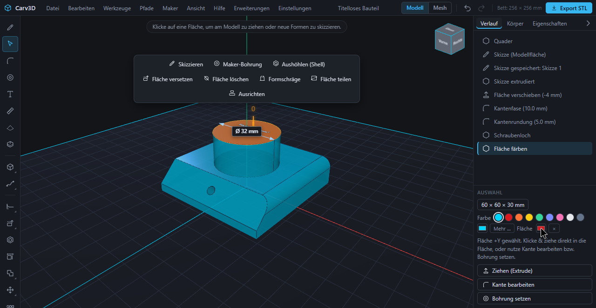

## Inhalt

1. [Schnellstart](#1-schnellstart)
2. [Oberfläche und Navigation](#2-oberfläche-und-navigation)
   - [2.1 Das Fenster](#21-das-fenster) · [2.2 Die Ansicht bewegen](#22-die-ansicht-bewegen) · [2.3 Ansichtswürfel und Standardansichten](#23-ansichtswürfel-und-standardansichten) · [2.4 Auswählen](#24-auswählen) · [2.5 Mehrere Dinge auf einmal](#25-mehrere-dinge-auf-einmal) · [2.6 Kontextleiste und Auswahlrad](#26-kontextleiste-und-auswahlrad) · [2.7 Genaue Werte eintippen](#27-genaue-werte-eintippen) · [2.8 Befehlssuche](#28-befehlssuche) · [2.9 Körper, Skizzen und Verlauf](#29-körper-skizzen-und-verlauf) · [2.10 Rückgängig und Wiederholen](#210-rückgängig-und-wiederholen) · [2.11 Tastenkürzel ändern](#211-tastenkürzel-ändern) · [2.12 Sprache und weitere Einstellungen](#212-sprache-und-weitere-einstellungen) · [2.13 Lernhilfen](#213-lernhilfen)
3. [Körper anlegen](#3-körper-anlegen)
   - [3.1 Grundkörper](#31-grundkörper) · [3.2 Drehkörper zeichnen](#32-drehkörper-zeichnen) · [3.3 Schraubenlinie und Feder](#33-schraubenlinie-und-feder) · [3.4 Text](#34-text)
4. [Skizzen](#4-skizzen)
   - [4.1 Skizze beginnen](#41-skizze-beginnen) · [4.2 Formen zeichnen](#42-formen-zeichnen) · [4.3 Maße eintippen](#43-maße-eintippen) · [4.4 Ecken verrunden und fasen](#44-ecken-verrunden-und-fasen) · [4.5 Spiegeln und Muster](#45-spiegeln-und-muster) · [4.6 Projizieren und Referenzbild](#46-projizieren-und-referenzbild) · [4.7 Kontur-Operationen](#47-kontur-operationen) · [4.8 Extrudieren und Ausschneiden](#48-extrudieren-und-ausschneiden) · [4.9 Konstruktionsebenen](#49-konstruktionsebenen)
5. [Körper bearbeiten](#5-körper-bearbeiten)
   - [5.1 Flächen ziehen und drücken](#51-flächen-ziehen-und-drücken) · [5.2 Radius runder Flächen ändern](#52-radius-runder-flächen-ändern) · [5.3 Kanten runden und fasen](#53-kanten-runden-und-fasen) · [5.4 Aushöhlen](#54-aushöhlen) · [5.5 Fläche versetzen, löschen und heilen](#55-fläche-versetzen-löschen-und-heilen) · [5.6 Kante versetzen](#56-kante-versetzen) · [5.7 Fläche teilen](#57-fläche-teilen) · [5.8 Formschräge](#58-formschräge) · [5.9 Kante oder Ecke verschieben](#59-kante-oder-ecke-verschieben) · [5.10 Größe ändern](#510-größe-ändern) · [5.11 Verschieben, Drehen, Skalieren, Spiegeln, Kopieren](#511-verschieben-drehen-skalieren-spiegeln-kopieren) · [5.12 Ausrichten](#512-ausrichten) · [5.13 Muster](#513-muster) · [5.14 Körper verbinden](#514-körper-verbinden) · [5.15 Körper teilen mit Passstiften](#515-körper-teilen-mit-passstiften)
6. [Pfade, Sweep, Loft und Drehen](#6-pfade-sweep-loft-und-drehen)
7. [Befestigen: Bohrungen, Taschen und Gewinde](#7-befestigen-bohrungen-taschen-und-gewinde)
8. [Farben und Materialien](#8-farben-und-materialien)
9. [Generatoren](#9-generatoren)
10. [Mesh-Modus](#10-mesh-modus)
    - [10.1 Formen mit Pinseln](#101-formen-mit-pinseln) · [10.2 Punkte, Verfeinern und Glätten](#102-punkte-verfeinern-und-glätten) · [10.3 Rechenwege: exakt und Netz](#103-rechenwege-exakt-und-netz)
11. [Messen und Schnittansicht](#11-messen-und-schnittansicht)
12. [Druck vorbereiten](#12-druck-vorbereiten)
    - [12.1 Mein Drucker](#121-mein-drucker) · [12.2 Druckbarkeit prüfen](#122-druckbarkeit-prüfen) · [12.3 Druckvorschau und Ausrichtung](#123-druckvorschau-und-ausrichtung) · [12.4 Übergabe an den Slicer](#124-übergabe-an-den-slicer)
13. [Dateien: Projekte, Import und Export](#13-dateien-projekte-import-und-export)
    - [13.1 Projekte](#131-projekte) · [13.2 Automatische Sicherung und Wiederherstellung](#132-automatische-sicherung-und-wiederherstellung) · [13.3 Import](#133-import) · [13.4 Export](#134-export)
14. [KI und MCP](#14-ki-und-mcp)
15. [Erweiterungen](#15-erweiterungen)
16. [Lernwege und Beispiele](#16-lernwege-und-beispiele)
17. [Bekannte Grenzen](#17-bekannte-grenzen)
18. [Hilfe und Rückmeldung](#18-hilfe-und-rückmeldung)
- [A. Tastenkürzel](#a-tastenkürzel) · [B. Glossar](#b-glossar)

---

## 1. Schnellstart

Carv3D folgt einem kurzen Arbeitsablauf: Drucker einstellen, exakte Volumenkörper erzeugen, funktionale Details ergänzen, Druckbarkeit prüfen, anschließend speichern und exportieren.

1. Öffne **Maker → Mein Drucker …** und trage Druckbett, Düsengröße und Passungszugabe ein (siehe [12.1](#121-mein-drucker)). Löcher, Wandprüfung und das Bettraster nutzen diese Werte.
2. Beginne mit **Datei → Neuer Quader** (oder einer Skizze) und tippe exakte Maße in Millimetern ein.
3. Wähle Flächen, Kanten oder ganze Körper aus und wende das passende Werkzeug an. Die [Kontextleiste](#26-kontextleiste-und-auswahlrad) bietet die richtigen Werkzeuge an.
4. Führe **Maker → Druckbarkeit prüfen …** aus.
5. Speichere das bearbeitbare `.carv`-Projekt mit **Datei → Projekt speichern** und exportiere als 3MF, STL oder STEP (siehe [13](#13-dateien-projekte-import-und-export)).

**Hilfe → Einführung …** startet eine geführte Tour von etwa 15 Minuten: Du baust Schritt für Schritt eine Getränkedose (Zylinder, Ansicht drehen und zoomen, Farbe, Fase, Skizze, Extrusion, Push/Pull, Text). Jeder Schritt markiert, was du anklicken sollst, und wartet auf die richtige Eingabe. Geht etwas schief, erklärt die Tour es in einfachen Worten, und **Schritt neu starten** stellt den letzten sicheren Stand wieder her. Dein früheres Projekt wird vor dem Start gesichert und lässt sich am Ende zurückholen.

Die Einheit ist Millimeter. Das Druckbett ist das Raster in der Ansicht; die Körper stehen darauf. Achsen: X zeigt nach rechts, Y nach oben, Z auf dich zu (vorne).

## 2. Oberfläche und Navigation

### 2.1 Das Fenster

- **Menüleiste** (oben): Datei, Bearbeiten, Werkzeuge, Pfade, Maker, Ansicht, Hilfe, Erweiterungen, Einstellungen. Rechts neben den Menüs: der Name des Bauteils, der Schalter **Modell | Mesh**, die Knöpfe Rückgängig und Wiederholen, die Bettgröße („Bett: 256 × 256 mm“) und der Knopf **Export STL**. Die Menüs lassen sich mit der Tastatur bedienen (Pfeiltasten, Enter, Esc).
- **Werkzeugleiste** (links): die wichtigsten Werkzeuge. Zusammengehörige Werkzeuge sind gruppiert: Fahre über einen Gruppenknopf, dann klappt seine Liste auf; der Knopf merkt sich das zuletzt benutzte Werkzeug. Die Gruppen sind neue Formen, Pfade, Körper verbinden (Vereinigen, Subtrahieren, Schnittmenge), Transformieren (Verschieben, Drehen, Skalieren, Spiegeln), Muster, Kantenwerkzeuge und Flächenwerkzeuge. **Körper löschen** steht ganz unten.
- **Ansicht** (Mitte): Das Raster ist dein Druckbett. Der [Ansichtswürfel](#23-ansichtswürfel-und-standardansichten) sitzt oben rechts; eine Hinweiszeile oben sagt, was du als Nächstes tun kannst.
- **Seitenleiste** (rechts): die Reiter **Verlauf**, **Körper** und **Eigenschaften**; der Pfeil klappt die Leiste ein. Darunter zeigt das Feld **Auswahl** die Größe der Auswahl, die Farbfelder und Knöpfe wie **Ziehen (Extrude)**, **Kante bearbeiten**, **Bohrung setzen** und **Größe ändern**.
- **Werkzeugleiste unten:** Braucht ein Werkzeug Einstellungen (Bohrung, Kante, Kante versetzen, Skizze, Druckvorschau …), erscheint seine Leiste unten in der Ansicht mit den Werten und **Fertig** oder **Abbrechen**.
- **Meldungen:** Klappt eine Aktion nicht, erscheint eine Meldung mit Grund und Hinweis. **Rückgängig** bringt dich immer zum letzten guten Stand zurück.

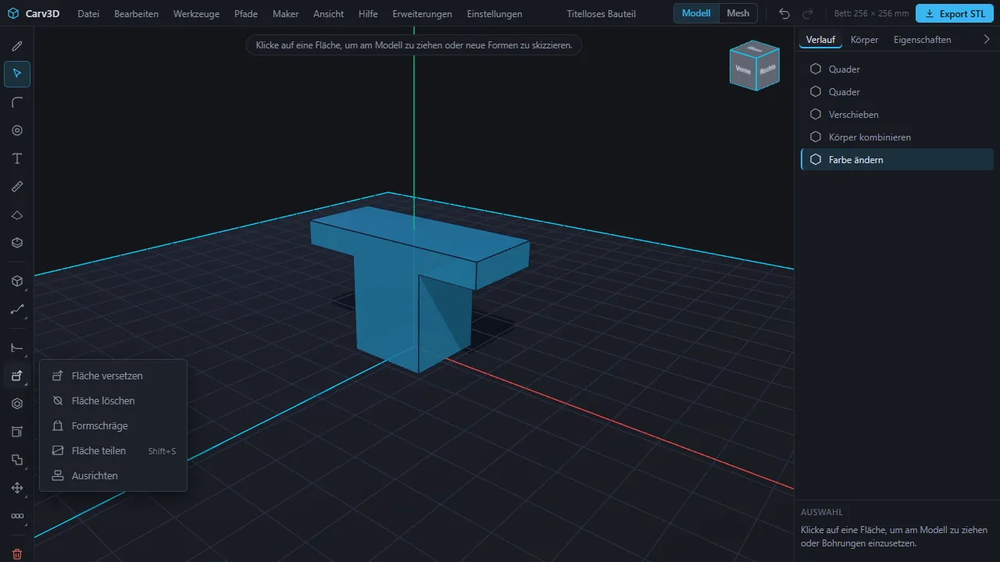

### 2.2 Die Ansicht bewegen

Unter **Einstellungen → Maussteuerung** gibt es sechs Vorlagen. Wähle die, die du gewohnt bist; Carv3D merkt sie sich im Browser. Das Mausrad zoomt immer. Der Schalter **Zum Mauszeiger zoomen** im selben Menü zoomt zum Zeiger statt zur Bildmitte.

| Vorlage (Reihenfolge in der Liste) | Drehen | Verschieben | Linke Taste im Leerraum |
| --- | --- | --- | --- |
| 1. Standard (wie bisher) | linke oder rechte Taste | mittlere Taste | dreht die Ansicht |
| 2. Rechte Taste dreht | rechte Taste | mittlere Taste oder Umschalt + rechte | wählt; zieht einen Auswahlrahmen |
| 3. Mittlere Taste dreht | mittlere Taste | Umschalt + mittlere | wählt; zieht einen Auswahlrahmen |
| 4. Mittlere Taste dreht, Strg verschiebt | mittlere Taste | Strg + mittlere | wählt; zieht einen Auswahlrahmen |
| 5. Mittlere Taste verschiebt | Umschalt + mittlere | mittlere Taste | wählt; zieht einen Auswahlrahmen |
| 6. Trackpad / Einhand | linke Taste im Leerraum | rechte Taste | dreht die Ansicht |

Die Namen der Vorlagen 2 bis 5 im Menü erinnern an verbreitete 3D-Programme; die Tabelle beschreibt, was jede tut.

**Leertaste** fokussiert die gewählte Fläche (und startet auf einer ebenen Fläche eine Skizze). **Esc** hebt die Auswahl auf.

### 2.3 Ansichtswürfel und Standardansichten

Klicke eine Seite des **Ansichtswürfels** (oben rechts), und die Kamera fliegt in diese Ansicht. Dieselben Ansichten gibt es als **Ansicht → Isometrisch / Von oben / Von vorne / Von rechts** und per Tastatur: **Strg + 1** isometrisch, **2** vorne, **3** hinten, **4** oben, **5** unten, **6** rechts, **7** links. Das Auswahlrad hat außerdem einen Ring **Ansichten**.

### 2.4 Auswählen

- **Fläche anklicken:** Die ganze Fläche wird hervorgehoben, und ein Pfeil zum Ziehen erscheint. Das Feld Auswahl zeigt ihre Größe.
- **Kante anklicken:** Die Kante leuchtet auf, und die Leiste **Kante bearbeiten** erscheint. Auch die Endpunkte einer Kante lassen sich anfassen (siehe [5.9](#59-kante-oder-ecke-verschieben)).
- **Körper doppelklicken:** wählt den ganzen Körper. Ein Griff daneben verschiebt und dreht ihn, und das Feld Auswahl bietet **Größe ändern**.
- **Leerraum anklicken** oder **Esc:** hebt die Auswahl auf.
- **M** blendet die Maße des Körpers ein oder aus.

### 2.5 Mehrere Dinge auf einmal

- **Umschalt + Klick** nimmt Flächen oder Kanten desselben Körpers hinzu oder heraus, bei anderen Körpern bildet sie eine Gruppe. **Strg + A** wählt alle Körper.
- Ein **Doppelklick** auf eine Kante wählt ihre ganze Kette (siehe [5.3](#53-kanten-runden-und-fasen)). Bei mehreren gewählten Kanten wirken Runden und Fasen auf alle; bei mehreren gewählten Flächen öffnet **Aushöhlen (Shell)** alle.
- Eine Gruppe von Körpern hat eine eigene Leiste mit **Verbinden**, **Abziehen**, **Schnittmenge**, **Duplizieren**, **Löschen** und **Auswahl aufheben**. Beim **Abziehen** ist der zuerst gewählte Körper derjenige, der ausgeschnitten wird. Der Griff verschiebt und dreht die ganze Gruppe in einem Schritt. **Strg + C** und **Strg + V** kopieren und fügen Körper ein, **Strg + D** dupliziert sie.
- **Auswahlrahmen:** In den Vorlagen, in denen die linke Taste im Leerraum frei ist (2 bis 5), ziehst du einen Rahmen auf. **Von links nach rechts** (durchgezogen, blau) wählt er nur, was ganz im Rahmen liegt; **von rechts nach links** (gestrichelt, grün) alles, was ihn berührt. **Tab** wechselt den Filter zwischen **Körper** und **Flächen** (die sichtbaren, zugewandten Flächen); **Esc** bricht ab.

### 2.6 Kontextleiste und Auswahlrad

Die **Kontextleiste** oben in der Ansicht bietet immer die Aktionen an, die zur Auswahl passen:

| Du hast gewählt | Aktionen |
| --- | --- |
| eine Fläche | Skizzieren, Maker-Bohrung, Aushöhlen (Shell), Fläche versetzen, Fläche löschen, Formschräge, Fläche teilen, Ausrichten |
| mehrere Flächen | Aushöhlen (Shell), Fläche löschen, Formschräge |
| eine Kante | Abrunden (Fillet), Abschrägen (Fase), Rundung mit Verlauf, Ungleiche Fase, Kante versetzen, Aus gewählten Kanten (legt einen Pfad an) |
| einen Körper | Skalieren, Spiegeln, Lineares Muster, Muster entlang Pfad, Ausrichten, Körper teilen, Duplizieren, Körper löschen |
| eine Gruppe von Körpern | Verbinden, Abziehen, Schnittmenge, Duplizieren, Löschen |

Aktionen, die nicht passen (zum Beispiel **Aushöhlen (Shell)** auf einer gekrümmten Fläche), sind abgedunkelt und nennen den Grund, wenn du darauf zeigst.

Das **Auswahlrad** bietet dieselben Aktionen am Mauszeiger an. Halte **Q**, bewege die Maus zu einem Eintrag und lasse los; manche Einträge öffnen einen zweiten Ring. Loslassen in der Mitte oder **Esc** bricht ab; die Tasten **1** bis **8** wählen einen Eintrag direkt. Ohne Auswahl bietet das Rad Neuer Quader, Neuer Zylinder, Skizzieren, Auswählen / Ziehen, Pfade und Ansichten an; in der Skizze die Zeichenwerkzeuge; im Mesh-Modus die Pinsel. In Vorlagen, in denen die rechte Taste nicht dreht, öffnet auch das Halten der rechten Maustaste das Rad (abschaltbar unter **Einstellungen → Auswahlrad: rechte Maustaste halten**).

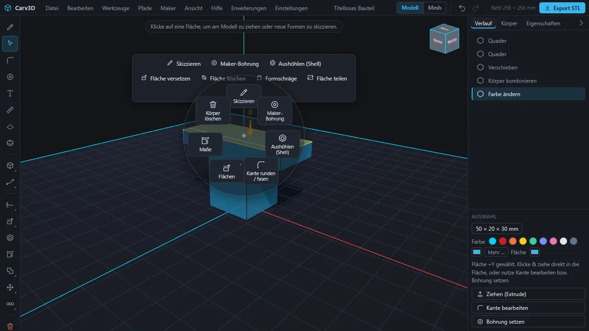

### 2.7 Genaue Werte eintippen

Jede Zahl, die du ziehen kannst, hat ein Maßfeld. **Tippe einfach eine Zahl** (Ziffern, Komma oder Punkt, Minus), und das Eingabefeld öffnet sich; **Enter** bestätigt, **Esc** verwirft. **Tab** springt zum nächsten Feld. Ein negativer Wert drückt eine Fläche in den Körper hinein, ein positiver zieht sie heraus. Werkzeugleisten bestätigst du mit **Enter**, **Fertig** oder einem Klick ins Leere und verwirfst mit **Esc**.

### 2.8 Befehlssuche

**Ansicht → Befehlssuche …** (**Strg + K**) findet jeden Menübefehl und jedes Werkzeug beim Tippen. Sie ignoriert Groß- und Kleinschreibung sowie Umlaute und versteht Wortanfänge und Anfangsbuchstaben. Pfeiltasten wählen, **Enter** führt aus, **Esc** schließt. Zuletzt benutzte Befehle stehen vorn. In der Skizze findet sie auch die Skizzenwerkzeuge.

### 2.9 Körper, Skizzen und Verlauf

- **Reiter Körper:** Jeder Körper hat ein Auge (ein- oder ausblenden), einen Namen (Doppelklick zum Umbenennen) und **Nur diesen zeigen**; **Alle wieder zeigen** bringt die anderen zurück. Ein Klick wählt den Körper. Ausgeblendete Körper sind nicht anklickbar und werden nicht exportiert. Darunter zeigt die Liste **Skizzen** gespeicherte Skizzen mit Auge, Umbenennen, **Skizze bearbeiten** und **Skizze löschen**.
- **Reiter Verlauf:** eine Liste aller Schritte, die du getan hast (auch Schritte eines MCP-Clients). Sie ist ein Protokoll; zurück geht es mit **Rückgängig**.
- **Reiter Eigenschaften:** Maße, Volumen, Anzahl der Flächen und Kanten des gewählten Körpers.

### 2.10 Rückgängig und Wiederholen

**Bearbeiten → Rückgängig** (**Strg + Z**) und **Bearbeiten → Wiederholen** (**Strg + Y** oder **Strg + Umschalt + Z**) gelten für jeden Modellierschritt, auch für Skizzen, Pfade, Farben und Importe. Die Knöpfe oben rechts tun dasselbe.

### 2.11 Tastenkürzel ändern

**Einstellungen → Tastenbelegung …** listet jede Aktion mit ihren Tasten. Klicke auf ein Feld und drücke die neue Taste oder Kombination; **Rücktaste** entfernt die Belegung, **Esc** bricht ab, **+** legt eine zweite Taste auf dieselbe Aktion. Ist eine Taste schon vergeben, fragt Carv3D, ob getauscht werden soll. Tasten, die der Browser für sich behält (etwa Strg + W), lassen sich nicht belegen. **Zurücksetzen** und **Alles zurücksetzen** stellen die Standardtasten wieder her; **Exportieren** und **Importieren** sichern und laden die Belegung als Datei. Tooltips und die Kürzelliste (**F1**) zeigen deine Tasten. Die Standardtasten stehen in [Anhang A](#a-tastenkürzel).

### 2.12 Sprache und weitere Einstellungen

Unter **Einstellungen** findest du **Sprache** (Deutsch, English), **Maussteuerung**, **Rechenweg (Schnitte, Löcher)**, **Auswahlrad: rechte Maustaste halten** und **Tastenbelegung …**. Der Rechenweg wählt zwischen **Automatisch**, **Immer exakt** und **Immer schnell** (siehe [10.3](#103-rechenwege-exakt-und-netz)).

### 2.13 Lernhilfen

- **Hilfe → Einführung …:** die geführte Tour (siehe [Abschnitt 1](#1-schnellstart)).
- **Hilfe → Benutzerhandbuch …:** das Handbuch im Programm mit vier vollständigen Beispielprojekten. **Beispielprojekt laden** ersetzt nach einer Rückfrage das geöffnete Dokument; speichere deine Arbeit also vorher.
- **Kurze „So geht’s“-Videos:** Viele Werkzeuge zeigen in ihrem Tooltip einen Abspielknopf; das Video läuft stumm in einer Schleife, mit Untertiteln in der Sprache der Oberfläche.
- **Hilfe → Tastenkürzel …** (**F1**) zeigt die Kürzelübersicht.

## 3. Körper anlegen

### 3.1 Grundkörper

| Werkzeug (Werkzeugleiste, Gruppe der neuen Formen) | Ergebnis |
| --- | --- |
| **Neuer Quader** (**R**, auch **Datei → Neuer Quader**) | Quader 50 × 50 × 15 mm |
| **Neuer Zylinder** (**C**, auch **Datei → Neuer Zylinder**) | Zylinder Ø 50 mm, 20 mm hoch |
| **Neue Kugel** | Kugel, Radius 20 mm |
| **Neues Ellipsoid** | gestreckte Kugel mit den Halbachsen 30, 18 und 22 mm |
| **Neuer Kegel** | Kegel, Grundradius 20 mm, 40 mm hoch |
| **Neuer Ring (Torus)** | Ring, Ringradius 25 mm, Rohrradius 7 mm |

Der neue Körper steht am Ursprung auf dem Druckbett. **Hinweis:** Er kann vorhandene Körper überlappen; verschiebe ihn gleich nach dem Anlegen. Exakte Maße stellst du mit einem Doppelklick auf den Körper und **Größe ändern** ein ([5.10](#510-größe-ändern)). Bei runden Körpern (Zylinder, Kugel, Kegel, Ring) baut „Größe ändern“ den Körper mit dem neuen Durchmesser neu auf.

### 3.2 Drehkörper zeichnen

**Drehkörper zeichnen** (in derselben Gruppe) öffnet ein kleines Zeichenfenster: Klicke Punkte ins Profil (links liegt die Drehachse), ziehe Punkte zum Verschieben, Doppelklick löscht einen Punkt. **Glatte Kurve durch die Punkte** rundet das Profil. **Erzeugen** dreht es zu Vase, Becher, Flasche oder Kuppel. Das Werkzeug **Skizze drehen** ([6](#6-pfade-sweep-loft-und-drehen)) tut dasselbe aus einer gespeicherten Skizze.

### 3.3 Schraubenlinie und Feder

- **Feder:** **Pfade → Feder …** (**Umschalt + F**). Trage **Außen-Ø**, **Draht-Ø**, **Steigung**, **Windungen**, runden oder Vierkantdraht und die Gängigkeit ein, dann **Feder erzeugen**. Die Feder steht auf dem Druckbett. Die Steigung muss größer sein als der Drahtdurchmesser, und der Draht muss in der Mitte ein Loch lassen; sonst erklärt eine Meldung, was zu ändern ist.
- **Schraubenlinie** (eine Kurve, kein Körper): Im Werkzeug **Pfad** gibt es **Schraubenlinie:** mit **Radius**, **Steigung**, **Windungen** (bis 200), **Achse** (X, Y, Z, waagerechte oder senkrechte Skizzenachse oder eine gewählte Kante) und rechts- oder linksgängig, dann **Schraubenlinie anlegen**. Entlang ihr lässt sich ein Profil ziehen ([6](#6-pfade-sweep-loft-und-drehen)).

### 3.4 Text

Wähle eine ebene Fläche und in der Werkzeugleiste **Text gravieren / prägen**. In **Text auf Fläche** gibst du den **Text** ein, wählst **Gravieren (vertieft)** oder **Prägen (erhaben)** und stellst **Größe**, **Tiefe / Höhe**, **Drehung** und die Versätze **X** und **Y** in Millimetern ein. Der Text wird mittig auf der Fläche platziert. **Anwenden** erzeugt echte Buchstaben. Beispiel: Text „CARV“, Gravieren, Größe 7, Tiefe 0,8 mm. Text, der bündig als eigener farbiger Körper in eine Tasche eingesetzt wird („Einlage“), ist über die Befehlsschnittstelle möglich ([14](#14-ki-und-mcp)), nicht über diesen Dialog.

## 4. Skizzen

Eine Skizze ist eine flache Zeichnung auf einer Ebene oder einer Fläche. Geschlossene Formen werden zu **Profilen**, die du zu Körpern extrudierst oder ausschneidest. Skizzen werden im Projekt gespeichert und bleiben bearbeitbar.

### 4.1 Skizze beginnen

1. Wähle eine **ebene Fläche** (oder nichts, um danach eine Ebene zu wählen).
2. Wähle **Skizzieren** (**S**; auch in der Kontextleiste, oder **Leertaste** auf einer ebenen Fläche).
3. Wähle auf Nachfrage eine Ebene: **Oben (XY)**, **Vorne (XZ)**, **Rechts (YZ)**, eine ebene Modellfläche oder eine [Konstruktionsebene](#49-konstruktionsebenen).

Direkt auf einer gekrümmten Fläche zu skizzieren geht nicht; wähle eine ebene Fläche oder eine Ebene. Die Kamera richtet sich senkrecht auf die Ebene aus; **Normal zu Skizze** in der Werkzeugleiste tut das erneut, wenn du die Ansicht verdreht hast. **Skizze beenden** (**Esc**) verlässt den Skizziermodus. Die Skizze wird automatisch als „Skizze 1“, „Skizze 2“ … gespeichert.

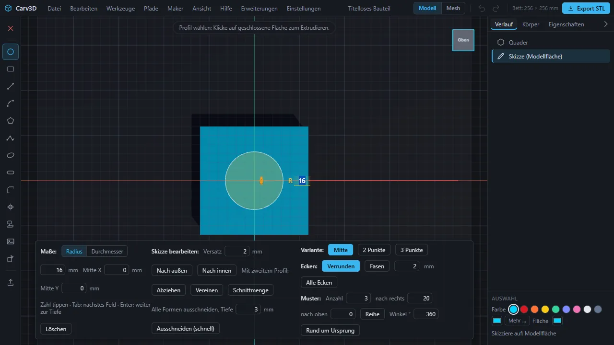

Die Leiste unten in der Skizze hat drei Spalten: **Maße:** (Werte für die Form eintippen, die du gerade zeichnest), **Skizze bearbeiten:** (Versatz, Verknüpfen, alles ausschneiden) und rechts **Variante:**, **Ecken:** (Verrunden) und **Muster:** (Wiederholen). Sie werden in den nächsten Abschnitten erklärt.

### 4.2 Formen zeichnen

| Werkzeug | Taste | So geht es |
| --- | --- | --- |
| **Kreis** | **C** | Mittelpunkt klicken, Radius aufziehen, erneut klicken. **C** noch einmal wechselt die Variante: aus 2 Punkten (Durchmesser) oder aus 3 Punkten |
| **Rechteck** | **R** | eine Ecke klicken, gegenüberliegende Ecke klicken. **R** noch einmal: von der Mitte oder aus 3 Punkten |
| **Linie** | **L** | Punkte klicken; eine Zahl tippen für die genaue Länge (**Tab**: Winkel). **Enter** schließt ab. Geschlossene Linienzüge werden zum Profil |
| **Bogen** | **A** | in einer Linie: Anfang, Ende, dann ein Punkt, der die Wölbung bestimmt. **A** noch einmal wechselt zurück zu geraden Strecken |
| **Vieleck** | **P** | Mittelpunkt klicken, zur ersten Ecke ziehen und klicken; Eckenzahl mit Pfeil hoch/runter oder per Zahl |
| **Kurve (Spline)** | **S** | Punkte klicken, die Kurve läuft glatt hindurch; **Enter** oder ein Klick auf den ersten Punkt schließt sie |
| **Ellipse** | **O** | Mittelpunkt klicken, beide Halbachsen aufziehen, klicken |
| **Langloch** | **N** | die Mitten beider Enden klicken, dann die Breite; die Enden werden Halbkreise |

Bei Kreis und Rechteck wählen auch die Knöpfe **Variante:** in der Skizzenleiste die Variante (beim Kreis **Mitte**, **2 Punkte**, **3 Punkte**). Ellipsen, Bögen und Langlöcher bleiben exakt. Eine Form in einer anderen Form wird automatisch zum **Loch** der äußeren: Ein Kreis im Rechteck ergibt extrudiert eine Platte mit Loch. Entfernst du die innere Form, ist die Fläche wieder voll.

### 4.3 Maße eintippen

Beim Zeichnen zeigt der Teil **Maße:** der Skizzenleiste Felder wie **Radius** (mit einem Schalter zu **Durchmesser**), **Breite**, **Höhe**, **Mitte X** und **Mitte Y**. Tippe eine Zahl, **Tab** springt zum nächsten Feld, **Enter** geht weiter zur Tiefe, **Löschen** entfernt die Form.

### 4.4 Ecken verrunden und fasen

Wähle **Ecken verrunden** (**F**) und klicke eine Ecke; ein Klick in eine Fläche bearbeitet alle ihre Ecken. In der Leiste wählst du **Verrunden** oder **Fasen** (oder **Alle Ecken**) und stellst das Maß ein. Meldungen erklären, wenn eine Ecke nicht zu verrunden ist (die Nachbarkanten sind kürzer als das Maß, eine Ecke neben einem Bogen, eine Form mit eigenen Löchern).

### 4.5 Spiegeln und Muster

- **Spiegeln** (**M**): Wähle mit dem Auswahlwerkzeug ein Profil und klicke dann zwei Punkte, die die Spiegellinie festlegen. Die gespiegelte Kopie entsteht neben dem Original.
- **Muster:** Mit gewähltem Profil wiederholt die Leiste **Muster:** es als **Reihe** (Anzahl, Schritt **nach rechts** und **nach oben**) oder **Rund um Ursprung** (Anzahl und Winkel).

### 4.6 Projizieren und Referenzbild

- **Projizieren** (**J**): Klicke eine Fläche eines Körpers; ihr Umriss und ihre Löcher werden senkrecht auf die Skizzenebene gelegt und stehen dort als Formen bereit. So baust du auf vorhandener Geometrie weiter, zum Beispiel einen Deckel zu einer Box. Eine Fläche, die senkrecht zur Skizzenebene steht, ergäbe nur eine Linie; eine Meldung erklärt das. Einzelne Kanten lassen sich noch nicht projizieren.
- **Referenzbild:** Legt ein Foto oder eine Zeichnung halbtransparent unter die Skizze, damit du sie nachzeichnen kannst. Stelle **Breite mm**, Lage, **Drehung °** und **Deckkraft** ein; **Entfernen** nimmt es weg. Das Bild bleibt auf deinem Rechner und endet mit der Skizze.

### 4.7 Kontur-Operationen

Die Leiste **Skizze bearbeiten:** wirkt auf das gewählte Profil:

- **Versatz**, **Nach außen** oder **Nach innen**, um einen Abstand, den du eintippst (zum Beispiel eine Wandstärke aus einem Umriss). Ist die Form für den Versatz zu klein, sagt das eine Meldung.
- **Mit zweitem Profil:** **Abziehen**, **Vereinen** oder **Schnittmenge**; klicke danach das zweite Profil in der Skizze.
- **Alle Formen ausschneiden, Tiefe … → Ausschneiden (schnell):** schneidet alle Formen der Skizze in einem Schritt in den darunterliegenden Körper, auch Hunderte Löcher in etwa einer Sekunde. **Hinweis:** Der Körper wird danach ein Netzkörper (siehe [10](#10-mesh-modus)): Glatte Flächen bleiben für den Druck fein genug, aber Rundungen und Gewindelöcher sind darauf nicht mehr möglich.

### 4.8 Extrudieren und Ausschneiden

Klicke eine geschlossene Fläche der Skizze an (**Profil wählen**) und wähle **Extrudieren** (**E**). Ziehe den Pfeil oder tippe den Weg. Carv3D entscheidet, was das Ergebnis ist, und sagt es in der Statuszeile:

- **Neuer Körper**, wenn die Skizze auf keinem Körper liegt,
- **Hinzufügen / Vereinigen**, wenn du aus einem Körper herausziehst (das neue Teil wird mit ihm verbunden),
- **Ausschneiden**, wenn du hineindrückst (negativer Weg).

**Verhalten der Beta:** Das Profil wird zunächst 20 mm herausgezogen, und ein getippter Wert wird dazu addiert (tippe −4, um bei 16 mm zu enden). Flächen mit Löchern ergeben Körper mit Löchern. Die Skizze bleibt nach dem Extrudieren im Projekt.

### 4.9 Konstruktionsebenen

Eine Konstruktionsebene ist eine Bezugsebene, die zu keinem Körper gehört, aber Skizzen trägt. **Ansicht → Konstruktionsebene …** (oder der Knopf in der Werkzeugleiste) öffnet die Leiste **Konstruktionsebene:**

1. Wähle die **Art:** **Versatz**, **Drehen um u-Achse** oder **Drehen um v-Achse**.
2. Wähle, **von** was sie ausgeht: einer Grundebene, der **Gewählten Fläche** oder einer vorhandenen Ebene, und tippe den Abstand oder Winkel.
3. **Anlegen.** Die Ebene erscheint als violette Fläche. In der Liste **Vorhandene** kannst du sie ein- oder ausblenden, löschen oder **Skizze darauf** drücken.

Ebenen werden im Projekt gespeichert und gehören zu Rückgängig.

## 5. Körper bearbeiten

### 5.1 Flächen ziehen und drücken

1. Klicke eine **ebene Fläche**. Ein orangefarbener Pfeil erscheint.
2. Ziehe den Pfeil, oder tippe eine Zahl und drücke **Enter**. Positiv zieht die Fläche heraus (fügt Material hinzu), negativ drückt sie hinein (nimmt Material weg).
3. Beim Ziehen rastet Carv3D an nahen Kanten ein (ein Hinweis sagt es; Zeiger wegbewegen löst es).

Hineindrücken geht auch an Körpern mit Rundungen, Fasen und schrägen Wänden; der Körper wird dort gekürzt. Liegt neben der gezogenen Fläche eine zweite Fläche in derselben Ebene (ein geteilter Deckel, zwei Zapfen gleicher Höhe), bewegt sich nur die angeklickte. **Ziehen (Extrude)** im Feld Auswahl startet dieselbe Aktion. Gekrümmte Flächen änderst du stattdessen über ihren Radius (nächster Abschnitt).

### 5.2 Radius runder Flächen ändern

Klicke die **Wand einer Bohrung**, die **Außenwand eines Zapfens oder Zylinders** oder eine **Rundung**. Derselbe orangefarbene Pfeil erscheint, mit einer Beschriftung wie „R 19 · Ø 38 mm“. Ziehe den Pfeil oder tippe einen Wert: Der Radius ändert sich live. Wie bei ebenen Flächen fügt ein positiver Wert Material hinzu: Ziehen in eine Bohrung hinein macht sie kleiner, Ziehen von ihr weg macht sie größer; ein Zapfen wird nach außen dicker; eine Außenrundung wird kleiner. Der kleinste Radius ist 0,05 mm. Beim Loslassen entsteht ein Verlaufsschritt **Fläche versetzt**. Kegelmantel, Kugeln und mehrere Flächen gleichzeitig lassen sich so noch nicht ändern.

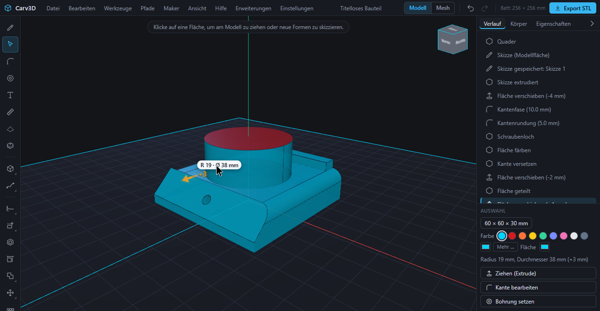

### 5.3 Kanten runden und fasen

1. Klicke eine Kante (**F** schaltet auf das Kantenwerkzeug; **Umschalt + Klick** nimmt weitere Kanten hinzu).
2. Wähle in der Leiste **Kante bearbeiten:** **Abrunden (Fillet)** oder **Abschrägen (Fase)**. Ziehe den Pfeil nach außen zum Runden oder nach innen zum Fasen, oder tippe den Wert (Radius bzw. Fasenbreite) und drücke **Enter**.
3. Die Kante ist gerundet oder gefast; **Rückgängig** nimmt es zurück.

**Ganze Kantenkette wählen:** Ein **Doppelklick** auf eine Kante wählt alle Kanten, die tangentenstetig an sie anschließen, zum Beispiel die ganze Oberkante eines Teils mit abgerundeten Ecken (gerade Stücke und Bögen zusammen). Die gewählten Kanten leuchten, die Statusleiste nennt ihre Zahl. Danach geht es wie oben weiter: **Abrunden** oder **Abschrägen** in der Leiste, Pfeil ziehen oder Maß tippen wirkt auf die ganze Kette. Ecken mit Knick beenden die Kette; **Alt + Doppelklick** wählt stattdessen die ganze Kantenschleife der Fläche unter dem Zeiger, auch mit Ecken (bei einem Quader die vier Kanten einer Seite). **Umschalt + Klick** nimmt danach einzelne Kanten heraus oder dazu. Passt der Radius nicht an allen Kanten und Ecken der Kette zugleich, sagt Carv3D es und rät zu einem kleineren Maß oder zu weniger Kanten.

Passt das Maß nicht, verkleinert Carv3D es und sagt es, oder bittet um einen kleineren Wert. Kanten, die schon rund sind, lassen sich nicht noch einmal runden.

- **Rundung mit Verlauf:** Der Radius wächst oder schrumpft gleichmäßig vom Anfang zum Ende der Kante. Trage **Radius Anfang** und **Radius Ende** ein.
- **Ungleiche Fase:** zwei Maße, eines je Fläche an der Kante. Trage **Maß erste Fläche** und **Maß zweite Fläche** ein und wähle, welche Fläche die erste ist (**Fläche A** oder **Fläche B**).

Beide stehen in der Kontextleiste und im Auswahlrad einer Kante, mit kurzem Video.

### 5.4 Aushöhlen

Wähle eine ebene Fläche (oder mehrere) und **Aushöhlen (Shell)** (**H**). Trage die **Wandstärke** ein; die gewählten Flächen bleiben offen, und der Körper wird mit gleichmäßiger Wand ausgehöhlt. Beispiel: ein Quader 90 × 60 × 28 mm mit 2,4 mm Wänden. Ist die Wand dicker als der halbe Körper, bittet eine Meldung um eine dünnere Wand.

### 5.5 Fläche versetzen, löschen und heilen

- **Fläche versetzen** verschiebt die gewählte Fläche um einen **Abstand (+ Material)**. An einer Bohrung, einem Zapfen oder einer Rundung ändert es den Radius (wie [5.2](#52-radius-runder-flächen-ändern)).
- **Fläche löschen** entfernt ein Merkmal und heilt den Körper: Eine **Bohrung** wird aufgefüllt, ein **Zapfen** abgetragen, eine **Rundung** wird wieder eine scharfe Kante, und eine **gerade Fase** zwischen zwei ebenen Flächen wird wieder eine scharfe Kante. Wähle die Wand des Merkmals und bestätige mit **Enter**.

Nicht jede Fläche lässt sich heilen. Taschen, Fasen an Ecken, an denen mehrere Fasen zusammentreffen, und Flächen von Kegeln oder Kugeln werden nicht unterstützt; eine Meldung sagt es.

### 5.6 Kante versetzen

*Kante versetzen* zieht auf einer Fläche eine Linie im Abstand von einer Kante und teilt die Fläche an ihr. Der Körper bleibt gleich, aber du bekommst eine neue Fläche, die du hochziehen oder eindrücken kannst: ein Zapfen, der ein paar Millimeter vom Rand beginnt, oder eine Vertiefung mit Rand.

1. Klicke eine Kante (oder wähle mehrere Kanten, die zur selben Fläche gehören).
2. Wähle **Kante versetzen** in der Kontextleiste.
3. Die Leiste zeigt **Abstand** und **Art der Versatzkante**: **Kette** nimmt die ganze zusammenhängende Kantenkette, **Einzelkante** nur die gewählte. Eine blaue Linie zeigt die Teilung vorab. Ziehe in der Ansicht, um den Abstand zu ändern, oder tippe ihn.
4. Bestätige mit **Fertig** (oder **Enter**).

Ein positiver Abstand läuft auf die ebene Nachbarfläche, ein negativer auf die andere Fläche der Kante. Geschlossene Ketten (eine Kreiskante, der Rand einer Bohrung) ergeben eine geschlossene Linie. Klicke danach die neue Fläche an und ziehe oder drücke sie, zum Beispiel −2 mm für eine Vertiefung.

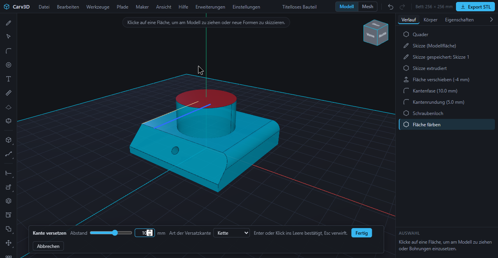

### 5.7 Fläche teilen

*Fläche teilen* schneidet eine ebene Fläche an einer Geraden, ohne die Form des Körpers zu ändern. Danach ist der kleinere Teil gewählt und lässt sich sofort ziehen oder eindrücken (eine Rippe, eine Stufe).

1. Wähle eine ebene Fläche und **Fläche teilen** (Kontextleiste, Auswahlrad, Werkzeugleiste oder **Umschalt + S**).
2. Klicke den ersten Punkt der Linie. Er rastet auf Ecken und Kantenmitten ein (ein Kreuz zeigt den eingerasteten Punkt).
3. Bewege den Zeiger: Eine blaue Vorschaulinie reicht bis zum Rand der Fläche und rastet auf die Richtung der Kanten und auf rechte Winkel ein. Klicke den zweiten Punkt (oder **Fertig** / **Enter**). **Esc** bricht ab.

Unterstützt werden nur ebene Flächen und gerade Linien.

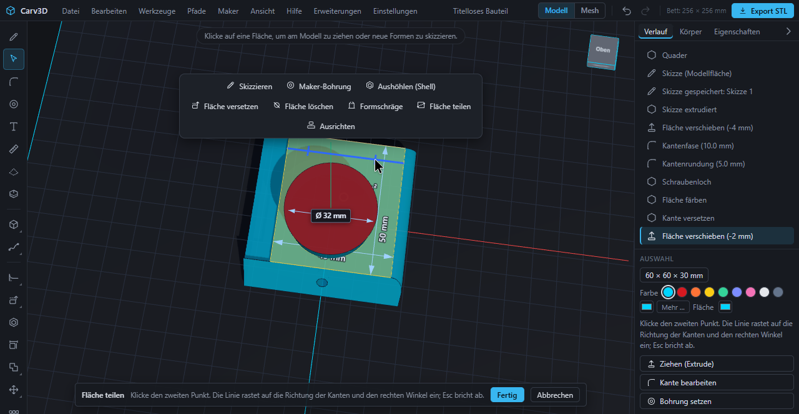

### 5.8 Formschräge

Die *Formschräge* neigt Wände um einen Winkel, sodass sie nach oben schmaler oder breiter werden; das hilft beim Entformen und spart Stützen. Wähle die Wände, wähle **Formschräge**, trage den **Winkel** (−30 bis 30°) und die **Zugrichtung** (**Nach oben** oder **Nach unten**) ein. Die Unterkante bleibt; von dort neigen sich die Wände. Der Winkel gilt absolut: Eine Wand, die schon geneigt ist, wird auf den eingegebenen Winkel gesetzt und nicht zusätzlich geneigt; ein Hinweis nennt die vorhandene Neigung.

### 5.9 Kante oder Ecke verschieben

Wähle eine Kante. In der Kantenleiste erscheinen **Kante verschieben**, **Ecke A** und **Ecke B**. Wähle eines davon und ziehe am Griff; **Esc** bricht ab. Die angrenzenden ebenen Flächen kippen mit. Das geht nur, wenn alle Flächen an der Kante eben sind, ohne Löcher und Rundungen; sonst sagt es eine Meldung. Runde Kanten nach dem Verschieben, nicht davor.

### 5.10 Größe ändern

Doppelklicke einen Körper und nutze **Größe ändern**: Tippe **Breite (X)**, **Höhe (Y)** und **Tiefe (Z)** in Millimetern. Rundungen und Nachbarflächen bleiben exakt. Runde Körper (Zylinder, Kegel, Kugel, Ring) werden mit dem neuen Durchmesser neu aufgebaut (Breite und Tiefe müssen gleich sein); Netzkörper werden achsweise gestreckt. Ein Körper, der schräg gestellt, gewölbt oder zusammengesetzt ist und in einer Richtung keine ebene Außenfläche hat, lässt sich nicht genau einstellen; **Skalieren** geht bei ihm.

### 5.11 Verschieben, Drehen, Skalieren, Spiegeln, Kopieren

- **Griff:** Bei ganz gewähltem Körper steht ein Griff daneben. Ziehe an seinen Teilen zum **Verschieben** oder **Drehen**; tippe einen Wert für genaue Beträge. Der Schalter **Kopieren** unter dem Griff legt eine Kopie an, statt das Original zu bewegen.
- **Verschieben** (**G**): X, Y und Z in Millimetern eintippen.
- **Drehen** (**Umschalt + R**): Wähle die **Achse** (X, Y oder Z) und den **Winkel** (Standard 90°). Der Körper dreht sich um seine Mitte. **Hinweis:** Ein gedrehter Körper kann unter das Druckbett sinken; die Druckprüfung meldet das.
- **Skalieren:** ein **Faktor** von 10 bis 400 %. Der Körper bleibt auf dem Druckbett.
- **Spiegeln** (**Umschalt + M**): Wähle eine ebene Fläche; der Körper wird an ihr gespiegelt, und beide Hälften werden verbunden.

### 5.12 Ausrichten

*Ausrichten* legt einen Körper auf einen anderen. Wähle den Körper (für **Fläche auf Fläche** eine ebene Fläche von ihm), wähle **Ausrichten** und den zweiten Körper als **Werkzeugkörper**. **Fläche auf Fläche** legt die gewählte ebene Fläche auf die am besten gegenüberliegende ebene Fläche des anderen Körpers (der Körper dreht sich bei Bedarf); **Abstand** stellt einen Zwischenraum ein. **Mitte auf Mitte** zentriert den Körper auf dem anderen.

### 5.13 Muster

- **Lineares Muster:** Wähle die **Achse**, die **Anzahl** (2 bis 20) und den **Abstand** in Millimetern. Das Ergebnis ist ein Körper aus dem Original und seinen Kopien.
- **Kreismuster:** **Anzahl** (2 bis 36) und **Gesamtwinkel**. Die Kopien werden um die senkrechte Achse durch den Ursprung verteilt.
- **Muster entlang Pfad:** siehe [6](#6-pfade-sweep-loft-und-drehen).

### 5.14 Körper verbinden

**Vereinigen** (**Strg + U**), **Subtrahieren** (**Strg + B**) und **Schnittmenge** (**Strg + I**) sind geführt: Wähle den Körper, der sich ändern soll, starte das Werkzeug und klicke den zweiten Körper an; **Esc** oder ein Klick ins Leere bricht ab. Der zweite Körper wird verbraucht. Die Körper müssen sich überlappen. Bei gewählter Gruppe nutzt du die Gruppenleiste ([2.5](#25-mehrere-dinge-auf-einmal)).

### 5.15 Körper teilen mit Passstiften

**Maker → Körper teilen …** schneidet einen Körper für den Druck in zwei Teile, zum Beispiel ein Teil, das zu groß für das Bett ist. Wähle die Richtung (**Links/Rechts**, **Oben/Unten**, **Vorn/Hinten**), die **Lage** des Schnitts und die Zahl der **Passstifte**; **Teilen**. Die Stifte und die passenden Löcher bekommen Spiel, damit sie gedruckt zusammenpassen. Beide Teile liegen druckfertig nebeneinander. Ist die Schnittfläche für Stifte dieser Größe zu schmal, wird ohne Stifte geteilt, und ein Hinweis sagt es.

Jede Richtung hat einen eigenen Schalter mit Regler für die Lage. Eine eingeschaltete Richtung gibt **2 Teile**, zwei Richtungen **4 Teile**, drei Richtungen **8 Teile**; die Leiste zeigt die Teilezahl. Mindestens eine Richtung bleibt eingeschaltet. Die Teile bleiben standardmäßig an ihrer Stelle und in ihrer Ausrichtung und werden nur etwas auseinandergeschoben (bei zwei Teilen 6 mm, im Befehl `gap`). Schaltest du **Zum Drucken auslegen** ein, werden sie gedreht (Schnittfläche nach unten) und nebeneinander auf das Bett gelegt, ohne in anderen Körpern zu landen.

Den Start findest du an vier Stellen: im Menü **Maker → Körper teilen …**, in der linken Leiste als **Teilen ohne Verbindung** und **Teilen mit Passstiften** (beide in einer Gruppe), in der Kontextleiste eines gewählten Körpers und im **Auswahlrad** (Taste **Q** halten, Körper gewählt): **Körper teilen** öffnet ein Untermenü mit **Ohne Stifte**, **Mit Passstiften**, **In 4 Teile** und **In 8 Teile**.

**Wieder zusammenstecken:** **Maker → Geteilte Teile zusammenstecken** (auch in der Kontextleiste und im Auswahlrad, wenn mehrere Körper gewählt sind; ohne Auswahl werden alle Körper versucht) setzt die Teile so zusammen, dass jeder Stift in seinem Loch sitzt und die Schnittflächen sich berühren. Carv3D liest dafür Stifte und Löcher aus der Form der Teile: Du darfst die Teile vorher bearbeiten (zum Beispiel Kanten runden) oder verschieben. Die Stifte einer Schnittfläche sind unterschiedlich dick, damit die Teile nur in einer Lage passen. Bei Teilungen ohne Stifte gibt es nichts zusammenzustecken. Bei 8 Teilen werden nicht immer alle untergebracht; die Meldung nennt, wie viele passten. Beim Auslegen zum Drucken legt Carv3D die Teile so ab, dass sie in keinem anderen Körper liegen.

## 6. Pfade, Sweep, Loft und Drehen

Das Menü **Pfade** (und die Gruppe in der Werkzeugleiste) enthält sechs Werkzeuge mit einer gemeinsamen Leiste: **Pfad zeichnen …** (**Umschalt + P**), **Sweep …** (**Umschalt + W**), **Skizze drehen …** (**Umschalt + D**), **Loft …** (**Umschalt + L**), **Muster entlang Pfad …** (**Umschalt + A**) und **Feder …** (**Umschalt + F**, siehe [3.3](#33-schraubenlinie-und-feder)).

- **Pfad:** eine 3D-Kurve. Wähle die **Art** (**Linienzug** oder **Glatte Kurve**, auf Wunsch **Geschlossen**) und eine Arbeits-**Ebene** (**Boden**, **Vorne**, **Seite** oder **Gewählte Fläche**). Drücke **Zeichnen** und klicke Punkte; **Rücktaste** nimmt den letzten Punkt zurück; **Enter** oder Doppelklick beendet. Wechselst du die Ebene, läuft die Kurve in die dritte Richtung weiter: Setze die ersten Punkte auf dem Boden und wechsle dann auf **Vorne**, um einen Punkt in die Höhe zu setzen. Ein Pfad entsteht auch **Aus gewählten Kanten** (Kanten, die ineinander übergehen) oder als **Schraubenlinie**. Pfade stehen im Bild (Anfang grün, Ende rot), werden im Projekt gespeichert und lassen sich in der Liste **Pfade** ein- oder ausblenden und löschen.
- **Sweep:** zieht eine Skizzenfläche (**Profil**) entlang eines **Pfads**: Rohre, Griffe, Schienen. **Ende** verjüngt das Profil zum Ende hin (in Prozent), **Verdrehung** dreht es über die Länge. Ein Loch im Profil bleibt offen (Hohlrohr). Das **Ergebnis** ist ein **Neuer Körper**, oder **Vereinigen mit** bzw. **Abziehen von** einem Körper. **Sweep ausführen.**
- **Skizze drehen:** dreht eine Skizzenfläche um eine **Achse** (waagerechte oder senkrechte Skizzenachse, X-, Y- oder Z-Achse oder eine gewählte gerade Kante) um einen **Winkel** von 1 bis 360°: Ringe, Knöpfe, Räder, Vasen. Mit **Abziehen von** entsteht eine Nut. Eine Fläche, die auf beiden Seiten der Achse liegt, würde sich selbst durchdringen; eine Meldung erklärt das.
- **Loft:** verbindet zwei bis vier Skizzenflächen auf verschiedenen Ebenen zu einem glatten Körper (zum Beispiel von einem Kreis zu einem Quadrat). Wähle die **Querschnitte** der Reihe nach; **Glatt** oder gerade. Flächen mit Löchern lassen sich nicht loften. **Loft ausführen.**
- **Muster entlang Pfad:** vervielfältigt einen Körper entlang eines Pfads nach **Anzahl** oder **Abstand (mm)**; **Mitdrehen** dreht die Kopien mit der Richtung des Pfads. Der Körper sollte am Anfang des Pfads stehen. Höchstens 200 Kopien. **Vervielfältigen.**

## 7. Befestigen: Bohrungen, Taschen und Gewinde

Das Werkzeug **Maker-Bohrung** (**Umschalt + H**; in der Kontextleiste, im Auswahlrad oder als **Bohrung setzen** im Feld Auswahl) setzt passende Öffnungen für Schrauben, Einsätze, Muttern und Magnete.

1. Wähle die Fläche, in die es gehen soll (eben, schräg oder gekrümmt), und starte das Werkzeug. Die Leiste **Maker-Bohrung:** erscheint.
2. Wähle einen Eintrag aus der Liste (unten).
3. Fahre mit dem Zeiger über die Fläche: Eine Vorschau folgt und rastet auf der Oberfläche ein. Klicke, um die Position festzulegen.
4. Auf ebenen Flächen zeigen die Felder **Mitte bis Kante:** (← → ↑ ↓) die Abstände zu den nächsten Kanten: Tippe Werte, um die Mitte genau zu setzen, oder schiebe die Vorschau mit gedrückter Maustaste.
5. **Schnitt anwenden** (oder **Enter**) schneidet das Loch; **Abbrechen** verwirft es.

| Eintrag in der Liste | Größen |
| --- | --- |
| **Schraube durchgehend, Zylinderkopf versenkt** | M2, M2.5, M3, M4, M5, M6, M8 |
| **Schraube durchgehend, Senkkopf bündig** | M2 bis M8 |
| **Schraube durchgehend, ohne Kopfsenkung** | M2 bis M8 |
| **Schraube schneidet Gewinde selbst in den Kunststoff** | M2 bis M8 (Kernloch) |
| **Gewinde modellieren (ab M6)** | M6, M8, M10, M12, M14, M16, M20, M24, M30: ein echtes Innengewinde; die Tiefe gibst du ein |
| **Gewindeeinsatz (Heat-Set) einschmelzen** | M2, M2.5, M3, M4, M5, M6 |
| **Mutter-Tasche (Sechskant)** und **Mutter-Tasche mit Einschub von der Seite** | M2 bis M8 |
| **Magnet-Tasche (Scheibenmagnet)** | 5×2, 6×3, 8×3, 10×3, 10×5, 12×3, 15×3, 20×3 mm (Durchmesser × Höhe) |
| **Freie Bohrung (Ø / Tiefe)** | Ø 1 bis 60 mm, Tiefe 1 bis 100 mm, Passung **Festsitz (+0.05)**, **Standard (+0.20)** oder **Spiel (+0.35)** |

Bei allen Tabelleneinträgen kommen Maße und Spiel aus gepflegten Hardware-Tabellen und aus **Mein Drucker** (Passungszugabe und Schrumpfung); die Leiste sagt es. Mache einmal einen Testdruck und stelle die Passungszugabe nach, wenn Schrauben klemmen oder wackeln.

**Schräge und gekrümmte Flächen.** Auf einer Fläche in beliebigem Winkel oder auf Kegel, Zylinder und Kugel zeigt das Werkzeug entlang der **Flächennormalen an der angeklickten Stelle**, nicht entlang einer Achse. Randabstände werden an der echten Flächenkontur gemessen (eine Warnung erscheint, wenn zu wenig Wand bleibt). Ein Durchgangsloch reicht bis zur Innenseite der ersten Wand; auf achsparallelen Flächen geht es durch den ganzen Körper. Taschen und die Kopfsenkung bekommen auf gekrümmten Flächen einen **ebenen Boden**; ein Hinweis nennt die Tiefe am Rand, und ist die Krümmung zu stark, lehnt das Werkzeug ab und schlägt eine flachere Stelle, eine größere Tiefe oder ein kleineres Teil vor.

**Grenzen.** Ein modelliertes Innengewinde braucht eine **ebene Fläche** (eine schräge geht); an einer gekrümmten Wand nimm ein selbstschneidendes Kernloch oder einen Gewindeeinsatz. Das Eintippen der Kantenabstände geht nur auf ebenen Flächen. Ein Gewinde braucht einige Sekunden Rechenzeit und macht den Körper schwerer. Liegt die gewählte Stelle ohne Werkstoff (in einer vorhandenen Bohrung oder im Hohlraum einer Schale), wird nichts geschnitten, und eine Meldung sagt es.

Platzhalterkörper für Schrauben, Muttern und Scheiben sowie Gewindestangen mit Schraubenkopf lassen sich mit Befehlen für Montage- und Kollisionsprüfung anlegen ([14](#14-ki-und-mcp)); einen Werkzeugknopf dafür gibt es noch nicht. Ein vollständiges Gewindepaar steckt im Beispielprojekt [M10-Bolzen mit Innengewinde](#m10-bolzen-mit-innengewinde).

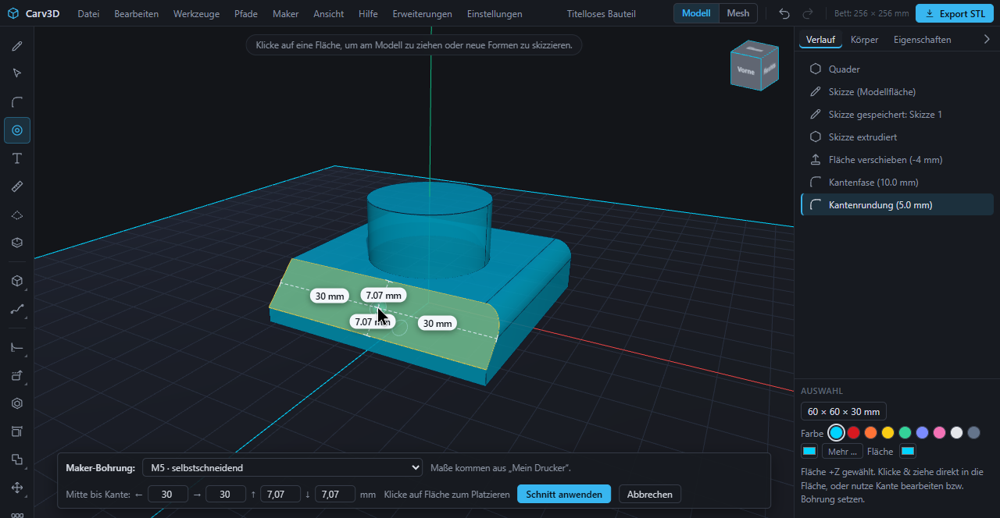

## 8. Farben und Materialien

- **Körperfarbe:** Wähle einen Körper; das Feld Auswahl zeigt neun Farbfelder und ein Feld für eine eigene Farbe. **Mehr …** öffnet die ganze Bibliothek.
- **Flächenfarbe:** Wähle eine Fläche; neben den Farbfeldern färbt ein Feld **Fläche** diese Fläche anders als den Körper. Das **×** daneben entfernt die Flächenfarbe. Die Farbe gehört zur zugrunde liegenden Fläche und bleibt deshalb bei Rundungen, Fasen, Bohrungen, Push/Pull, Verschieben, Drehen, Spiegeln und Skalieren an ihr, auch nach Rückgängig und im Projekt.
- **Farben & Materialien …** (Menü **Ansicht**, oder **Mehr …**): eine Bibliothek mit Suche. **Farben** hat 24 Farben; **Metall, Glanz, Seide, Glas** hat Kombinationen wie Metall Silber, Gold und Kupfer, Glänzend Rot, Seide Blau und Durchscheinend Klar. Du kannst auch jede Farbe als Hexwert eingeben (zum Beispiel `#d71920`). **Oberfläche** wählt **Standard**, **Matt**, **Glänzend**, **Metall**, **Seide** oder **Durchscheinend**. Die Oberfläche ändert nur, wie das Modell am Bildschirm aussieht; **gedruckt wird die Farbe.**
- **Als Darstellung speichern** legt Farbe und Oberfläche des gewählten Körpers unter einem Namen ab (mit dem Projekt gespeichert; sie lässt sich wieder löschen, und Körper behalten ihre Farbe, wenn du sie löschst).
- **Druckfarben (Plan):** Der Dialog gruppiert deine Körper und gefärbten Flächen nach Farbe und schätzt je Farbe Volumen und Filament in Gramm, mit dem Material deines Druckerprofils. Jede Zeile ist ein Filament („Filament 1: 12 g · 3 Körper“). Ein Mehrfarbdrucker lädt je Farbe ein Filament; ohne ein solches System ist die Farbe nur Darstellung.

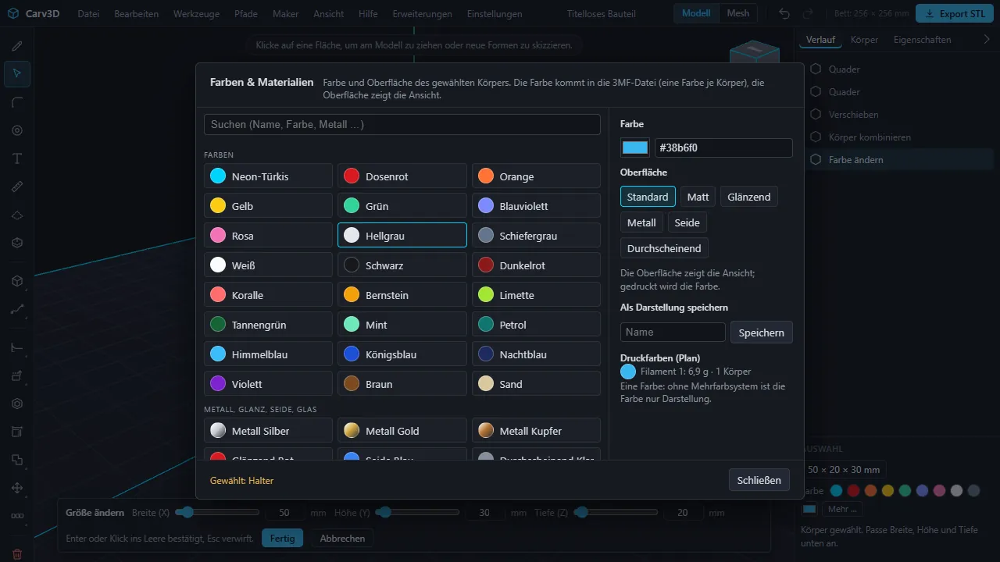

**3MF und Slicer.** Der 3MF-Export schreibt eine Farbe je Körper, eine Farbe je Dreieck bei gefärbten Flächen und die Körpernamen als Objektnamen. Für Slicer derselben Familie (**Bambu Studio**, **OrcaSlicer**, **Anycubic Slicer Next**) schreibt er zusätzlich die Filament-Nummer je Objekt, in der Reihenfolge des Farbplans. Das Ergebnis wurde am Bildschirm in **Anycubic Slicer Next** bestätigt (der Slicer legt die Filamente an und übernimmt die Farben). **Bambu Studio** und **OrcaSlicer** lesen dieselbe Dateistruktur, und **PrusaSlicer** liest die Standardfarben der 3MF; diese drei haben wir am Bildschirm noch nicht geprüft. Prüfe die Farben in deinem Slicer, bevor du mehrfarbig druckst.

**Grenzen.** Flächen in derselben Ebene teilen sich eine Farbe, und eine neue Fläche in einer gefärbten Ebene übernimmt diese Farbe. Netzkörper haben keine einzelnen Flächen und lassen sich nur als Ganzes färben. Farben aus importierten 3MF-Dateien werden nicht gelesen.

## 9. Generatoren

**Maker → Generatoren …** öffnet einen Dialog mit einer Liste fertiger Teile. Trage ein paar Maße ein, drücke **Erzeugen**, und der Generator baut die Körper und legt sie druckfertig auf das Druckbett. **Standardwerte** setzt das Formular zurück. Falsche Werte zeigen eine erklärende Meldung und lassen den Dialog offen.

**Box mit Deckel.** Eine Box mit abgerundeten Ecken, oben offen, und ein Deckel mit Stöpsel, der mit Spiel in die Öffnung passt. Beide sind exakte Körper. Der Deckel liegt neben der Box (Platte auf dem Bett, Stöpsel oben), sodass beide Teile ohne Stützen drucken. Wahlweise mit **Griffmulde** in der Vorderwand zum Aufhebeln und mit **Trennwänden**.

| Einstellung | Standardwert |
| --- | --- |
| Breite (X) / Tiefe (Z) / Höhe (mit Deckel) | 60 / 40 / 30 mm |
| Wandstärke / Bodenstärke | 2 / 2 mm |
| Eckenradius | 3 mm |
| Dicke der Deckelplatte / Höhe des Stöpsels | 2 / 4 mm |
| Spiel je Seite | 0,2 mm |
| Griffmulde | an |
| Trennwände quer zu X / quer zu Z / Stärke der Trennwände | 0 / 0 / 1,2 mm |

**Lampenschirm aus Geflecht.** Ein Zylinder, dessen Wand aus gewobenem Draht besteht: zwei Scharen schräger Drähte, die sich abwechselnd über und unter kreuzen, ein massiver Gewindering unten für die Lampenfassung mit Lichtlöchern ringsum und ein aufsteckbarer gewebter Deckel, der daneben liegt. Beide Teile sind Netzkörper. Die Drähte laufen steiler als 45°, damit der Schirm ohne Stützen druckt. Einstellbar sind der Durchmesser (Standard 46 mm), die Höhe (Standard 50 mm mit Deckel), das Gewinde (Standard M36), Zahl, Dicke und Neigung der Drähte, die Tiefe des Über-Unter, die Lichtlöcher, das Spiel des Deckels und die Glätte. Zu dichte oder unpassende Werte werden mit Hinweis abgelehnt; ein kleineres Gewinde erlaubt einen schmaleren Schirm (das Standardgewinde braucht etwa 46 mm). Das Erzeugen dauert einige Sekunden.

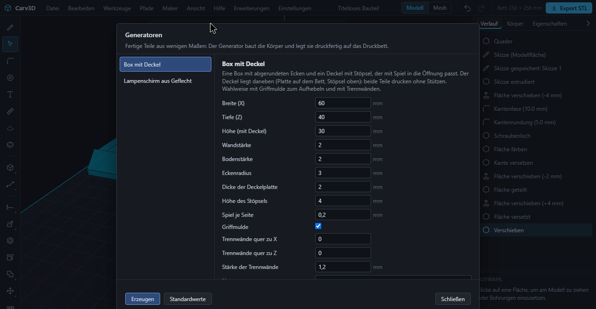

## 10. Mesh-Modus

Der Mesh-Modus formt einen Körper von Hand wie Ton: für Figuren, Griffe und organische Formen. Der Schalter **Modell | Mesh** in der oberen Leiste wechselt den Modus.

### 10.1 Formen mit Pinseln

1. Doppelklicke den Körper, den du formen willst, und schalte auf **Mesh**. Der Körper wird ein Netzkörper.
2. Wähle einen Pinsel (Tasten **1** bis **5**): **Greifen** zieht die Oberfläche mit der Maus mit; **Aufblasen** drückt sie nach außen (mit **Strg** nach innen, eine Delle); **Glätten** verteilt Unebenheiten; **Kneifen** zieht die Oberfläche zur Pinselmitte zusammen und schärft Falten; **Abflachen** ebnet die Oberfläche unter dem Pinsel ein.
3. Stelle **Radius** (Tasten **[** und **]**) und **Stärke** ein. **Spiegeln (X)** lässt den Pinsel zusätzlich spiegelbildlich an der X-Ebene wirken, für symmetrische Figuren.
4. Die linke Maustaste formt, die rechte dreht die Ansicht. **Zurück** nimmt den letzten Strich zurück, **Fertig** übernimmt das Ergebnis, **Abbrechen** verwirft es.

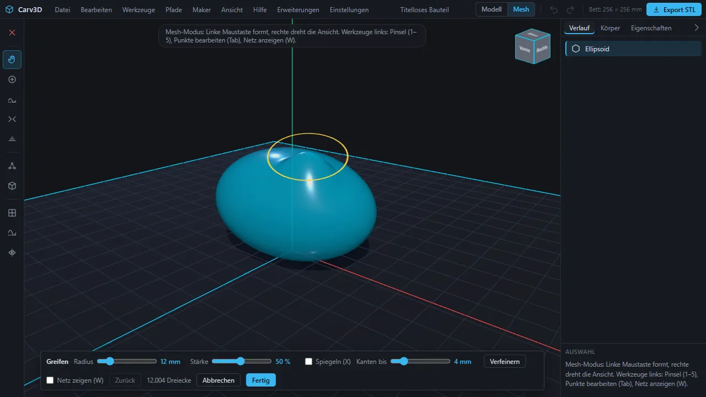

### 10.2 Punkte, Verfeinern und Glätten

- **Punkte bearbeiten** (**Tab**): Das Netz wird mit Punkten gezeigt. Klicke Punkte, wähle mehrere mit einem Rahmen (**Umschalt** erweitert) und fasse sie an: Sie folgen der Maus. **X**, **Y**, **Z** sperren die Richtung, **A** wählt alle Punkte, **Alt + A** keine; die **Weiche Auswahl** nimmt benachbarte Punkte sanft mit.
- **Netz anzeigen** (**W**) blendet die Netzlinien ein, damit du siehst, wie fein es ist.
- **Unterteilen** teilt jedes Dreieck in vier. **Verfeinern** teilt nur Kanten, die länger als **Kanten bis … mm** sind, und bringt so Detail dorthin, wo das Netz grob ist; sind Punkte gewählt, wirkt es nur zwischen ihnen. **Alles glätten** glättet das ganze Netz ein wenig.
- Das Netz darf bis zu 250 000 Dreiecke haben; die Leiste zeigt die Zahl. Sehr kräftige Striche können die Oberfläche zerreißen; das Netz muss geschlossen bleiben, sonst bittet eine Meldung um sanftere Striche.

### 10.3 Rechenwege: exakt und Netz

Exakte Körper und Netzkörper können im selben Projekt liegen. Netzkörper lassen sich verschieben, drehen, skalieren, färben, exportieren und weiter formen; mit dem schnellen Netz-Kern können sie außerdem mit anderen Körpern verbunden (vereinigen, abziehen, schneiden), gemustert und gebohrt werden. Rundungen, Fasen, Aushöhlen und die Flächenwerkzeuge brauchen einen exakten Körper (dupliziere ihn vor dem Formen, wenn du eine exakte Kopie behalten willst).

**Einstellungen → Rechenweg (Schnitte, Löcher)** wählt, wie Schnitte, Löcher, Vereinigungen und Muster berechnet werden:

- **Automatisch** nimmt den schnellen Netz-Kern nur für Netzkörper und für Körper mit mehr als 150 Flächen; einfache Körper bleiben exakt. Wird ein Körper umgewandelt, erscheint ein Hinweis; **Rückgängig** stellt den exakten Körper wieder her.
- **Immer exakt:** Flächen bleiben wählbar, aber dichte Körper werden langsam.
- **Immer schnell:** Körper werden Netzkörper ohne einzelne Flächen.

## 11. Messen und Schnittansicht

- **Messen:** Wähle eine Fläche und dann mit **Umschalt + Klick** eine zweite. Im Bild erscheint eine Maßlinie, und die Statuszeile zeigt den Abstand (bei parallelen Flächen den senkrechten Abstand, sonst den kürzesten Abstand) und den Winkel zwischen den Flächen; berühren sich die Flächen, steht das dort. Der Knopf **Messen** und **Ansicht → Messen (zwei Flächen) …** erklären die Bedienung. Das Feld Auswahl und **M** zeigen Maße der Auswahl: Längen gerader Kanten, Radius und Durchmesser runder Flächen, Fläche.
- **Schnittansicht:** Der Knopf **Schnittansicht** (oder **Ansicht → Schnittansicht**) schneidet alle Körper an einer Ebene auf. In der Leiste wählst du die **Achse** (X, Y, Z), verschiebst die **Lage** mit dem Regler, zeigst bei Bedarf die **Andere Seite** und beendest mit **Beenden**. Die Schnittfläche erscheint gefüllt. Auswählen, Messen und Werkzeuge arbeiten unter dem Schnitt weiter. Sie ist reine Darstellung und ändert das Modell nicht. Skizzieren beendet die Schnittansicht, und die Druckvorschau kann nicht gleichzeitig offen sein.

## 12. Druck vorbereiten

### 12.1 Mein Drucker

**Maker → Mein Drucker …** speichert deinen Drucker im Projekt: **Drucker** (eine Liste von Druckerprofilen gängiger Hersteller oder **Eigener Drucker**), **Material** (PLA, PETG, ABS, ASA, TPU 95A, PA6, PA12, PC, PLA-CF, PETG-CF oder **Eigenes Material**), **Druckbett Breite** und **Tiefe**, **Maximale Höhe**, **Düse**, **Schichthöhe**, **Schrumpfung** und **Passungszugabe**. Löcher werden um die Schrumpfung größer gezeichnet (im Zweifel 0 lassen). Die Passungszugabe ist zusätzliches Spiel für Löcher; 0,2 mm passt meist. Die Schrumpfung ist ein Erfahrungswert, keine Herstellerangabe: Prüfe Passungen mit einem Testdruck.

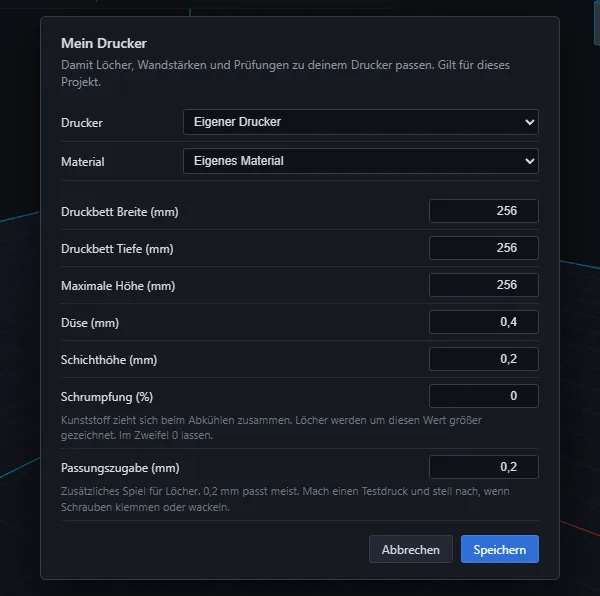

### 12.2 Druckbarkeit prüfen

**Maker → Druckbarkeit prüfen …** prüft alle Körper gegen dein Druckerprofil und erklärt jeden Befund in Alltagssprache, oft mit einem Knopf **Beheben**:

- Das Teil passt auf das **Bett** (Breite, Tiefe, Höhe) und ragt nicht darunter.
- Das Teil **schwebt** nicht über dem Bett.
- **Wände** sind nicht dünner, als deine Düse drucken kann.
- **Überhänge** (Flächen, die sich so weit nach außen neigen, dass sie Stützen brauchen) und **Brücken** (waagerechte Decken, die eine Lücke überspannen).

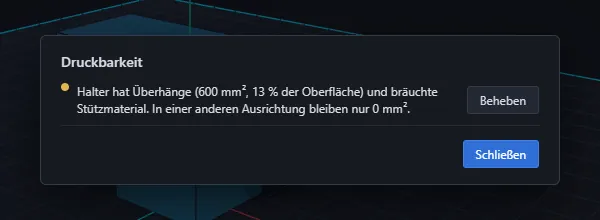

### 12.3 Druckvorschau und Ausrichtung

**Maker → Druckvorschau …** zeigt die Teile, wie sie gedruckt würden. Der Regler **Schicht** läuft durch die Schichten (Nummer und Höhe), **Überhänge zeigen** färbt die Problemstellen, und die Zeile darunter nennt das geschätzte Filamentgewicht und die Filamentlänge, den Überhangsanteil und die Zahl der Brücken samt längster Spannweite. **Beste Ausrichtung** dreht die Teile so, dass möglichst wenig Stützmaterial nötig ist (die Vorschau meldet, wenn die jetzige Ausrichtung schon die beste ist). Zu große Teile lassen sich mit [5.15](#515-körper-teilen-mit-passstiften) teilen.

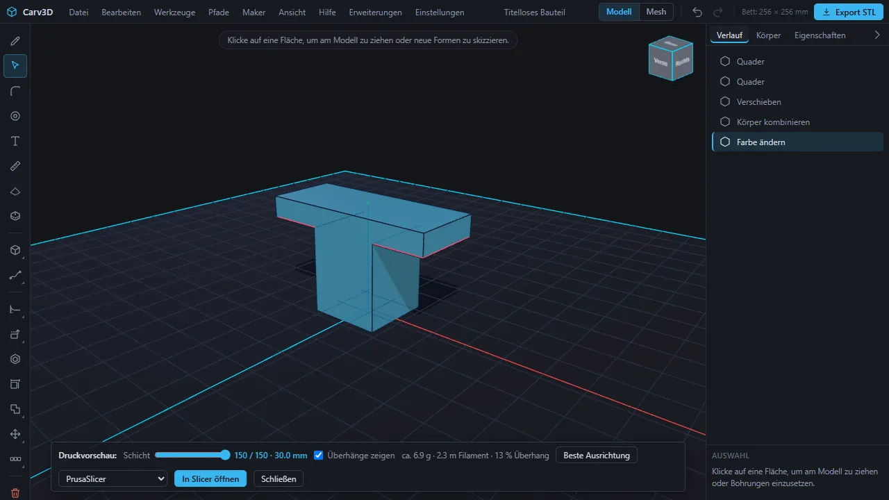

### 12.4 Übergabe an den Slicer

Wähle in der Druckvorschau einen Slicer und drücke **In Slicer öffnen**: Die Teile gehen als 3MF an **PrusaSlicer**, **OrcaSlicer**, **Bambu Studio** oder **Anycubic Slicer Next**. **Nur als Datei speichern** speichert stattdessen die 3MF. Die Datei geht nur über deinen eigenen Rechner. Das klappt mit dem Startskript des Beta-Pakets (lass dessen Fenster offen), das die Datei an den Slicer weitergibt. Öffnet sich der Slicer nicht (er ist für diesen Link nicht eingerichtet, oder Carv3D läuft ohne das Startskript), wird die Datei gespeichert; ziehe sie in den Slicer oder öffne sie dort. Anycubic Slicer Next startet das Startskript aus seinem Installationsordner, wenn er dort installiert ist.

## 13. Dateien: Projekte, Import und Export

### 13.1 Projekte

- **Datei → Projekt speichern** schreibt eine bearbeitbare `.carv`-Datei mit exakter Geometrie, Körpernamen, Farben, Skizzen, Pfaden, Konstruktionsebenen, Darstellungen und dem Druckerprofil. Dein Browser legt die Datei in seinem Download-Ordner ab.
- **Datei → Projekt öffnen …** öffnet eine `.carv`-Datei; das geht auch per Ziehen auf das Fenster. Das Öffnen ersetzt das aktuelle Dokument. Ältere Projektdateien lassen sich in neueren Versionen weiter öffnen; ein Projekt aus einer neueren Version verlangt, die App zu aktualisieren.
- **Behalte die `.carv`-Datei** auch nach dem Export: Netzexporte sind keine bearbeitbaren Masterdateien.

### 13.2 Automatische Sicherung und Wiederherstellung

Carv3D sichert deine Arbeit automatisch im Speicher des Browsers. Nach einem Absturz oder einem versehentlich geschlossenen Tab fragt der nächste Start **Arbeit wiederherstellen?** mit Uhrzeit und Zahl der Körper; **Wiederherstellen** macht dort weiter, **Neu beginnen** fängt von vorn an. Die automatische Sicherung liegt nur in diesem Browser: Sie ersetzt nicht, das Projekt als Datei zu speichern.

### 13.3 Import

**Datei → Modell importieren (STL, OBJ, 3MF, STEP, SVG, DXF) …**, oder ziehe eine Datei auf das Fenster:

| Format | Was du bekommst |
| --- | --- |
| **STEP** (`.step`, `.stp`) | jeder Volumenkörper wird ein exakter Körper (Bohrungen und Rundungen bleiben glatt), Einheiten werden nach mm umgerechnet, bis zu 50 Körper |
| **STL**, **OBJ** | ein geschlossenes Netz wird ein Körper, den du bohren, runden und verbinden kannst; bis zu 60 000 Dreiecke je Bauteil |
| **3MF** | jedes Bauteil der Bauplatte wird ein eigener Körper mit seiner Lage und Einheit; gleiche Grenze |
| **DXF** (ASCII) | eine **Skizze** auf der Grundebene: Kreise, Ellipsen sowie Linien oder Bögen, die sich zu geschlossenen Umrissen verbinden; Formen in Formen werden Löcher; Einheit aus der Datei. Offene Linien, Splines, Text und Blöcke werden gezählt und gemeldet, nicht übernommen |
| **SVG** | die gefüllten Formen werden zu einem Körper extrudiert, 3 mm hoch und 60 mm breit, mittig auf dem Bett; Formen in Formen werden Löcher; Konturen ohne Füllung werden ignoriert |

Netze müssen geschlossen sein. Ein offenes oder fehlerhaftes Netz wird mit Hinweis abgelehnt (repariere es zuerst in deinem Slicer); dichte Netze brauchen lange zum Einlesen.

### 13.4 Export

**Datei → Als STL exportieren …**, **Als 3MF exportieren …**, **Als STEP exportieren …** (und der Knopf **Export STL**) schreiben alle **sichtbaren** Körper.

- **3MF** ist das bevorzugte Format für aktuelle Slicer: Millimeter, Z oben, mit Farben und Körpernamen.
- **STL** (binär, Z oben) ist das am weitesten verstandene Format.
- **STEP** überträgt exakte Volumengeometrie in andere 3D-Programme; Netzkörper lassen sich nicht als STEP exportieren.

Nach Ablauf deines Testzeitraums (30 Tage ab dem ersten Start; für persönlich eingeladene Frühtester der 31. März 2027) lassen sich vorhandene Projekte weiter öffnen, speichern und exportieren.

## 14. KI und MCP

Jede Funktion von Carv3D ist ein Befehl, und dieselben Befehle steuern die Oberfläche, die Tests und den **lokalen MCP-Server**, den stereodruid entwickelt hat. Ein MCP-fähiger Assistent auf deinem Rechner kann deshalb mit dir oder für dich modellieren. In Carv3D ist **kein Cloud-Anbieter eingebaut**: Du gibst keinen API-Schlüssel in das Programm ein, die Geometrie bleibt auf deinem Rechner, und welche Werkzeuge du anbindest, entscheidest du. Der Server kann **ohne Oberfläche** laufen oder sich mit dem **geöffneten Carv3D-Fenster** verbinden, wo du jeden Schritt erscheinen siehst und wie gewohnt zurücknehmen kannst. **Hilfe → Einführung …** zeigt einen fertigen Konfigurationsblock für deinen Assistenten; die Installationsanleitung des Beta-Pakets beschreibt die Einrichtung.

Was die Befehle abdecken, ein Satz je Bereich:

- **Lesen:** Dokument, Körper, Auswahl, Flächen und Kanten, Messungen zwischen Flächen und Kanten.
- **Erzeugen:** Quader, Zylinder, Kugeln, Ellipsoide, Kegel, Ringe, Drehkörper, Lofts, Sweeps, Text, SVG- und DXF-Import, Schraubenlinien, Federn, Pfade.
- **Bearbeiten:** Push/Pull, Flächen versetzen und löschen, Fläche teilen, Kante versetzen, Rundungen und Fasen, Aushöhlen, Formschräge, Ausrichten, Größe ändern, Kanten und Ecken verschieben.
- **Transformieren und verbinden:** Verschieben, Drehen, Skalieren, Spiegeln, Duplizieren, lineare, kreisförmige und pfadgebundene Muster, Vereinigen, Abziehen, Schneiden, Teilen mit Stiften.
- **Skizzen und Ebenen:** Skizzen und Konstruktionsebenen anlegen, Formen hinzufügen, Ecken verrunden, Spiegeln, Muster, Flächen projizieren, Extrudieren und Ausschneiden.
- **Befestigen:** Schraubenlöcher, Mutter-, Magnet- und Einsatztaschen, Gewinde, Platzhalterkörper für Schrauben, Muttern und Scheiben, die Hardware-Tabelle.
- **Farben:** Körper- und Flächenfarben, Darstellungen, Palette, Farbplan.
- **Generatoren:** Box mit Deckel, Lampenschirm aus Geflecht.
- **Drucken:** Druckerprofil, Druckprüfung, Überhang-Analyse, beste Ausrichtung, Teilen.
- **Dateien:** Import, Export (STL, 3MF, STEP), Projekte speichern und laden, Rückgängig und Wiederholen, der Rechenweg.

Das öffentliche Repository enthält die MCP-Dokumentation nicht; das Beta-Paket beschreibt die Befehle.

## 15. Erweiterungen

Carv3D erhält eine **kontrollierte Erweiterungsschnittstelle**; der Anwendungskern bleibt geschlossen. Offizielle Community-Erweiterungen werden kostenlos angeboten, ihr Quellcode ist öffentlich einsehbar, und jede Erweiterung nennt ihre Berechtigungen. Aufnahme und Aktualisierung erfolgen erst nach automatischer und manueller Prüfung, und das veröffentlichte Paket wird aus dem geprüften Quellcode erstellt.

In dieser Beta gibt es das Menü **Erweiterungen → Erweiterungen verwalten …**: Es zeigt installierte Erweiterungen, ihre Befehle und Berechtigungen (das Dokument lesen, Körper und Skizzen anlegen und ändern, Dateien erzeugen) und lässt dich eine installieren, ausschalten oder entfernen. **Installiere nur Erweiterungen aus Quellen, denen du vertraust**; jeder Schritt einer Erweiterung steht im Verlauf und lässt sich rückgängig machen. **Ein offizielles Erweiterungsverzeichnis gibt es noch nicht, und öffentliche Einreichungen werden noch nicht angenommen.** Zuerst müssen Paketprüfung, Signaturen, eingeschränkte Berechtigungen und ein sicherer Aktualisierungsweg fertig sein. Siehe [Erweiterungen und Community-Beiträge](EXTENSIONS.de.md).

## 16. Lernwege und Beispiele

Arbeite sie der Reihe nach durch, wenn du neu bist. Die ersten vier Beispiele sind vollständige Projekte unter **Hilfe → Benutzerhandbuch …**.

### Winkelhalter mit Senkbohrungen

Ein praktisches Montageteil mit folgenden Grundlagen:

- Quader und exakte Maße
- 2-mm-Kantenrundungen
- zwei tabellengesteuerte M4-Senkbohrungen
- Boolesche Vereinigung zu einem druckbaren Volumenkörper

Übung: Flanschhöhe ändern, Lochpositionen über ihre Randabstände verschieben und den Halter als 3MF exportieren.

### Elektronikgehäuse mit Deckel

Ein zweiteiliges Projekt aus offenem Gehäuse und abnehmbarem Deckel. Es zeigt:

- Aushöhlen eines 90 × 60 × 28 mm großen Quaders auf 2,4 mm Wandstärke
- getrennte Körper und Sichtbarkeitssteuerung
- vier innere Dome mit Taschen für M3-Gewindeeinsätze
- vier M3-Zylinderkopfbohrungen im Deckel

Übung: Gehäusegröße ändern, einen Dom verschieben und eine Kabelöffnung in einer Seitenwand anlegen.

### Drehknopf mit D-Achsaufnahme

Ein kompaktes Beispiel für fortgeschrittene Formgebung:

- Rotationsprofil für das Grundvolumen
- kreisförmiges Muster mit sechzehn Griffnuten
- Boolesches Abziehen
- extrudiertes Polygon als formschlüssige Achsaufnahme

Übung: Zahl der Griffnuten oder Achsmaße ändern und anschließend die Druckbarkeit prüfen.

### M10-Bolzen mit Innengewinde

Ein funktionales zweiteiliges Gewindepaar:

- modelliertes M10-Außengewinde am Sechskantbolzen
- passendes M10-Innengewinde im separaten Block
- ISO-Regelsteigung von 1,5 mm
- 0,25 mm radiales Passungsspiel für den 3D-Druck

Übung: Ein weiteres Gewinde über das Bohrungswerkzeug erzeugen und das Passungsspiel an den eigenen Drucker anpassen. Unter M6 sind Gewindeeinsätze meist zuverlässiger.

### Speichern und Export

- **`.carv`** erhält bearbeitbare exakte Geometrie, Körpernamen, Farben, Skizzen und das Druckprofil.
- **3MF** ist das bevorzugte Format für moderne Slicer.
- **STL** eignet sich für breite Kompatibilität.
- **STEP** überträgt exakte Volumengeometrie in andere 3D-Programme.

Das `.carv`-Projekt sollte auch nach dem Export aufbewahrt werden, weil Netzexporte nicht als bearbeitbare Masterdatei gedacht sind.

### Vom Quader zum druckfertigen Teil (der Film, Schritt für Schritt)

Der [Vorstellungsfilm](../README.de.md) wurde im echten Programm mit genau diesen Schritten aufgenommen. Wenn du sie selbst nachvollziehst, berührst du die meisten der neueren Werkzeuge.

1. **Sockel.** **Datei → Neuer Quader**, doppelklicken, **Größe ändern** auf Breite 60, Höhe 14, Tiefe 60 mm.
2. **Zapfen.** Klicke die Oberseite, **Skizzieren**, wähle **Kreis**, klicke die Flächenmitte und ziehe einen Radius von 16 mm (Ø 32) auf. **Extrudieren** und tippe −4: Der Zapfen ist danach 16 mm hoch.
3. **Fase und Rundung.** Klicke die vordere obere Kante, **Abschrägen (Fase)**, tippe 10. Klicke die rechte obere Kante, **Abrunden (Fillet)**, tippe 5.
4. **Schraube auf der schrägen Fläche.** Klicke die Fasenfläche, starte **Maker-Bohrung**, wähle **Schraube schneidet Gewinde selbst in den Kunststoff** mit M5, fahre auf die Fläche, klicke, **Schnitt anwenden**.
5. **Farbe.** Klicke die Oberseite des Zapfens und wähle im Feld **Fläche** ein Rot.
6. **Kante versetzen.** Klicke die linke obere Kante, **Kante versetzen**, Abstand 10 mm, **Fertig**. Klicke den neuen Streifen und tippe −2, um ihn einzudrücken.
7. **Fläche teilen.** Schau von oben (**Strg + 4**), klicke die Oberseite des Sockels hinter dem Zapfen, **Fläche teilen**, klicke zwei Punkte für eine Linie und ziehe dann den kleineren Teil um 4 mm: Eine Rippe entsteht.
8. **Radius.** Klicke die Wand des Zapfens und ziehe am Pfeil: Der Radius ändert sich (R und Ø stehen im Bild).
9. **Generator.** Schiebe das Teil zur Seite, öffne **Maker → Generatoren …**, wähle **Box mit Deckel**, **Erzeugen**.
10. **Export.** **Datei → Als 3MF exportieren …**. Die Farben gehen in die Datei.

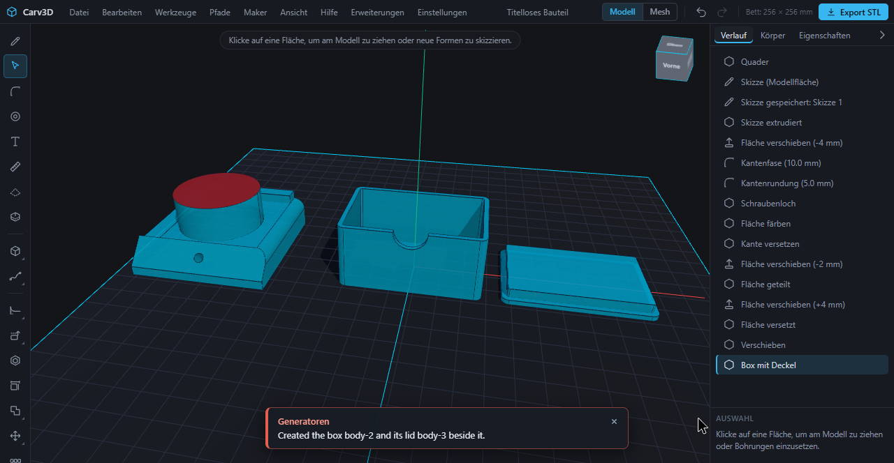

## 17. Bekannte Grenzen

Carv3D befindet sich in einer frühen Beta. Der aktuelle Schwerpunkt liegt auf direktem Modellieren und auf Bauteilen für den 3D-Druck.

**Allgemein**

- Bedienung und Dateiformat können sich während der 0.x-Phase noch ändern. Das Bearbeiten ist befristet: 30 Tage ab dem ersten Start (auf Anfrage verlängerbar), für persönlich eingeladene Frühtester bis einschließlich 31. März 2027; Öffnen, Speichern und Exportieren bleiben danach verfügbar. **Hilfe → Über Carv3D …** zeigt die verbleibenden Tage.
- Datenverlust lässt sich nicht ausschließen. Speichere `.carv`-Dateien und halte eine zusätzliche Kopie in einem Austauschformat wie STEP oder 3MF bereit; die automatische Sicherung liegt nur im Browser.
- Sehr große oder geometrisch komplizierte Modelle können langsam sein oder fehlschlagen. Stürzt der Geometrie-Kernel ab, wird er neu gestartet und der Körper wiederhergestellt (der Verlauf wird zurückgesetzt). Tablet- und Touch-Bedienung sind nicht vollständig optimiert, und es gibt noch keinen Installer (ein Paket mit Startskript).
- Neue Körper aus dem Menü entstehen am Ursprung und können vorhandene überlappen. Nach dem Extrudieren einer Skizze wird ein getippter Wert zur aktuellen Höhe addiert.

**Modellieren**

- Skizzen: kein Skizzieren auf gekrümmten Flächen; kein Zuschneiden und Verlängern; keine Maßbeziehungen (parallel, tangential, gleich …); einzelne Kanten lassen sich nicht projizieren; keine Konstruktionsachsen oder -punkte.
- Push/Pull arbeitet auf ebenen Flächen; der Radius lässt sich an Bohrungen, Zapfen, Zylindern und Rundungen ändern, aber nicht am Kegelmantel und an Kugeln und nicht für mehrere Flächen gleichzeitig.
- Fläche löschen heilt Bohrungen, Zapfen, Rundungen (Zylinderflächen) und gerade Fasen zwischen zwei ebenen Flächen, nicht Taschen oder Eckfasen. Fläche teilen geht auf ebenen Flächen mit geraden Linien. Kante versetzen geht auf ebenen Flächen; offene Ketten werden gerade bis zum Rand der Fläche verlängert. Eine Fläche zu ersetzen gibt es nicht.
- Kanten und Ecken verschieben braucht ebene Nachbarflächen ohne Löcher und Rundungen. Der Formschräge-Winkel gilt absolut, und die Neutralebene liegt am Boden des Körpers.
- Pfade haben noch keine Bögen (nur Linienzug oder glatte Kurve); ein Loft hat keine Führungskurven und nimmt keine Flächen mit Löchern. Pfade mit sehr vielen Punkten können scheitern.
- Ein modelliertes Gewinde braucht eine ebene Fläche und einige Sekunden; ohne vorgegebene Tiefe ist es auf 40 Windungen begrenzt. Bohrungen auf gekrümmten Flächen messen den Rand als Projektion, das ist eine Näherung.
- Netzkörper haben keine einzelnen Flächen oder Kanten: keine Rundungen, kein Aushöhlen, keine Flächenwerkzeuge, keine Flächenfarben und kein STEP-Export. Import und Verarbeitung dichter Netze können Minuten dauern; „Größe ändern“ eines gerundeten Quaders auf eine winzige Breite kann einen Rest hinterlassen; Runden einer Kante an einem importierten Facettenkörper kann ein falsches Volumen melden.

**Dateien und Druck**

- Der Import braucht geschlossene Netze bis 60 000 Dreiecke je Bauteil; STEP-Dateien eines Torus lassen sich noch nicht wieder einlesen; DXF-Dateien müssen ASCII sein; einen DXF-Export gibt es nicht; Farben importierter 3MF-Dateien werden nicht gelesen.
- Die Übergabe an den Slicer braucht das Startskript des Beta-Pakets; ohne es wird die 3MF als Datei gespeichert. Mehrfarbige 3MF-Ausgabe wurde am Bildschirm nur in Anycubic Slicer Next bestätigt (siehe [8](#8-farben-und-materialien)).
- Platzhalter für Schrauben, Muttern, Scheiben und Gewindestangen gibt es nur als Befehle, nicht als Werkzeugknöpfe.

Weitere bekannte Fehler stehen in den [Bekannten Einschränkungen](KNOWN_LIMITATIONS.de.md) und in den GitHub Issues.

## 18. Hilfe und Rückmeldung

- **Im Programm:** **Hilfe → Rückmeldung senden …** öffnet ein Formular für einen Fehler, eine Idee oder eine Frage. Es wird nichts automatisch gesendet: Du siehst genau, was mitgeht (auf Wunsch Version, Browser und letzte Fehler, nie deine Modelle), und schickst es selbst ab, durch Kopieren, per E-Mail oder als Meldung auf GitHub.
- **E-Mail:** beta@carv3d.de.
- **GitHub:** [Fehler melden](https://github.com/Carv3D-Studio/Carv3D/issues/new?template=bug_report_de.yml) · [Funktion vorschlagen](https://github.com/Carv3D-Studio/Carv3D/issues/new?template=feature_request_de.yml). Eine gute Meldung beschreibt den kürzesten Weg, das Problem nachzustellen, und nennt die Version (**Hilfe → Über Carv3D …**), das System und den Browser. Hänge Projektdateien nur an, wenn sie nichts Vertrauliches enthalten.
- **Sicherheitsprobleme** gehören nicht in öffentliche Issues; siehe [SECURITY.de.md](../SECURITY.de.md).
- Weiteres: [Hinweise für Betatests](BETA_TESTING.de.md) · [Aktuelle Funktionen](CAPABILITIES.de.md) · [Öffentliche Roadmap](../ROADMAP.de.md).

## A. Tastenkürzel

Jede Taste lässt sich unter **Einstellungen → Tastenbelegung …** ändern ([2.11](#211-tastenkürzel-ändern)). **Strg** gilt auf einem Mac auch als Befehlstaste.

| Bereich | Taste | Aktion |
| --- | --- | --- |
| Ansicht | Mausrad | zoomen |
| | **Leertaste** | auf Fläche fokussieren / skizzieren |
| | **Strg + 1** … **7** | isometrisch, vorne, hinten, oben, unten, rechts, links |
| | **Strg + K** | Befehlssuche |
| | **F1** | Tastenkürzel |
| | **Q** (halten) | Auswahlrad |
| | **M** | Maße ein- oder ausblenden |
| Bearbeiten | **Strg + Z** | Rückgängig |
| | **Strg + Y** oder **Strg + Umschalt + Z** | Wiederholen |
| | **Strg + C** / **V** / **D** / **A** | kopieren, einfügen, duplizieren, alle Körper wählen |
| | **Entf** oder **Rücktaste** | Körper löschen |
| | **Esc** | Auswahl aufheben oder abbrechen |
| | **Enter** | bestätigen |
| Modi | **V** | Auswählen / Ziehen |
| | **S** | Skizzieren |
| | **F** | Kante runden / fasen |
| | **Umschalt + H** | Maker-Bohrung |
| | **R** / **C** | Neuer Quader / Neuer Zylinder |
| | **Umschalt + P** / **W** / **D** / **L** / **A** / **F** | Pfad / Sweep / Skizze drehen / Loft / Muster entlang Pfad / Feder |
| Werkzeuge | **H** | Aushöhlen (Shell) |
| | **Umschalt + S** | Fläche teilen |
| | **G** | Verschieben |
| | **Umschalt + R** | Drehen |
| | **Umschalt + M** | Spiegeln |
| | **Strg + U** / **B** / **I** | Vereinigen / Subtrahieren / Schnittmenge |
| Skizze | **C** / **R** / **L** / **S** / **P** / **A** | Kreis / Rechteck / Linie / Kurve / Vieleck / Bogen |
| | **O** / **N** | Ellipse / Langloch |
| | **F** / **M** / **J** | Ecken verrunden / Spiegeln / Projizieren |
| | **E** | Extrudieren |
| | **Enter** | Linienzug abschließen |
| | **Esc** | Skizze beenden |
| Mesh-Modus | **1** … **5** | Pinsel: Greifen, Aufblasen, Glätten, Kneifen, Abflachen |
| | **[** / **]** | Pinsel kleiner / größer |
| | **Tab** | Punkte bearbeiten ein oder aus |
| | **W** | Netz anzeigen |
| | **A** / **Alt + A** | alle Punkte wählen / keine |
| | **X** / **Y** / **Z** | Achse sperren |

## B. Glossar

- **Körper:** ein fester Gegenstand in deinem Projekt. Ein Projekt kann viele enthalten.
- **Fläche, Kante, Ecke:** die ebenen oder gekrümmten Oberflächen eines Körpers, die Linien, an denen Flächen aufeinandertreffen, und die Punkte, an denen sich Kanten treffen.
- **Exakter Körper (Volumenkörper):** ein Körper mit exakten Oberflächen (ein rundes Loch ist wirklich rund), sodass er sich runden, bohren und als STEP exportieren lässt. Gegenstück: ein **Netzkörper** aus vielen kleinen Dreiecken, wie er beim Formen von Hand entsteht.
- **Skizze und Profil:** eine flache Zeichnung; eine geschlossene Fläche darin ist ein Profil, das sich extrudieren lässt.
- **Extrudieren:** eine flache Form zu einem Körper ziehen oder zum Ausschneiden hineindrücken.
- **Rundung und Fase:** eine abgerundete und eine abgeschrägte Kante.
- **Aushöhlen (Shell):** einen Körper auf eine bestimmte Wandstärke aushöhlen.
- **Boolesche Operation:** Körper durch Vereinigen, Abziehen oder Schneiden kombinieren.
- **Überhang und Brücke:** ein Teil des Modells, das sich so weit nach außen neigt, dass der Drucker Stützen darunter braucht; eine waagerechte Decke, die eine Lücke überspannt.
- **Slicer:** das Programm, das dein Modell in Anweisungen für den Drucker umrechnet.
- **3MF, STL, STEP:** Dateiformate. 3MF und STL sind Netze für Slicer (3MF kann Farben tragen); STEP trägt exakte Volumenkörper für andere 3D-Programme.
- **Düse, Schichthöhe, Passungszugabe:** die Öffnung der Druckdüse; die Dicke einer gedruckten Schicht; das zusätzliche Spiel, das Löchern gegeben wird, damit Teile passen.
- **Gewindeeinsatz (Heat-Set):** ein kleines Gewindeteil aus Metall, das in den Kunststoff eingeschmolzen wird.
- **MCP:** ein Standardweg, wie ein Assistenzprogramm die Befehle eines anderen Programms nutzt; hier immer auf deinem eigenen Rechner.
