# Carv3D user manual

**English** · [Deutsch](USER_MANUAL.de.md)

*Status: 2026-10-25, version 0.1.0-beta.1.* This manual describes what the current private beta can do and where its limits are. Planned work is not described here; see the [public roadmap](../ROADMAP.md).

Carv3D is a modeler for parts that will be 3D printed. You work directly on the model: click a face, pull it, type an exact value in millimetres and continue. There is no feature tree to maintain. Everything below is written so that you can start without CAD experience; words you may not know are explained in the [glossary](#b-glossary).

> **Try before you apply:** the restricted [live demo](https://carv3d-studio.github.io/Carv3D/) runs in your browser (no download, no account). It covers modeling, but saving, opening, importing and exporting are disabled there.

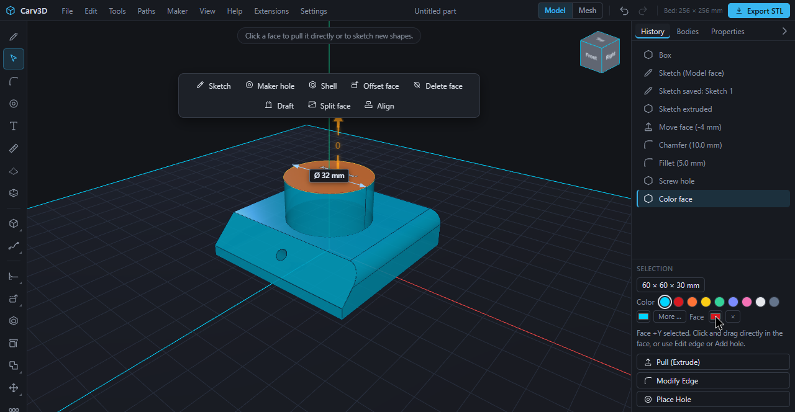

## Contents

1. [Quick start](#1-quick-start)
2. [The interface and navigation](#2-the-interface-and-navigation)
   - [2.1 The window](#21-the-window) · [2.2 Moving the view](#22-moving-the-view) · [2.3 View cube and standard views](#23-view-cube-and-standard-views) · [2.4 Selecting](#24-selecting) · [2.5 Several things at once](#25-several-things-at-once) · [2.6 Context bar and selection wheel](#26-context-bar-and-selection-wheel) · [2.7 Typing exact values](#27-typing-exact-values) · [2.8 Command search](#28-command-search) · [2.9 Bodies, sketches and history](#29-bodies-sketches-and-history) · [2.10 Undo and redo](#210-undo-and-redo) · [2.11 Changing keyboard shortcuts](#211-changing-keyboard-shortcuts) · [2.12 Language and other settings](#212-language-and-other-settings) · [2.13 Learning aids](#213-learning-aids)
3. [Creating bodies](#3-creating-bodies)
   - [3.1 Basic shapes](#31-basic-shapes) · [3.2 Drawing a revolve](#32-drawing-a-revolve) · [3.3 Helix and spring](#33-helix-and-spring) · [3.4 Text](#34-text)
4. [Sketches](#4-sketches)
   - [4.1 Starting a sketch](#41-starting-a-sketch) · [4.2 Drawing shapes](#42-drawing-shapes) · [4.3 Typing sizes](#43-typing-sizes) · [4.4 Rounding and chamfering corners](#44-rounding-and-chamfering-corners) · [4.5 Mirror and patterns](#45-mirror-and-patterns) · [4.6 Project and reference image](#46-project-and-reference-image) · [4.7 Contour operations](#47-contour-operations) · [4.8 Extruding and cutting](#48-extruding-and-cutting) · [4.9 Construction planes](#49-construction-planes)
5. [Editing bodies](#5-editing-bodies)
   - [5.1 Pushing and pulling faces](#51-pushing-and-pulling-faces) · [5.2 Changing the radius of round faces](#52-changing-the-radius-of-round-faces) · [5.3 Rounding and chamfering edges](#53-rounding-and-chamfering-edges) · [5.4 Shell](#54-shell) · [5.5 Offset, delete and heal faces](#55-offset-delete-and-heal-faces) · [5.6 Offset edge](#56-offset-edge) · [5.7 Split face](#57-split-face) · [5.8 Draft](#58-draft) · [5.9 Moving an edge or a corner](#59-moving-an-edge-or-a-corner) · [5.10 Resize](#510-resize) · [5.11 Move, rotate, scale, mirror, copy](#511-move-rotate-scale-mirror-copy) · [5.12 Align](#512-align) · [5.13 Patterns](#513-patterns) · [5.14 Combining bodies](#514-combining-bodies) · [5.15 Splitting a body with alignment pins](#515-splitting-a-body-with-alignment-pins)
6. [Paths, sweep, loft and revolve](#6-paths-sweep-loft-and-revolve)
7. [Fastening: holes, pockets and threads](#7-fastening-holes-pockets-and-threads)
8. [Colors and materials](#8-colors-and-materials)
9. [Generators](#9-generators)
10. [Mesh mode](#10-mesh-mode)
    - [10.1 Shaping with brushes](#101-shaping-with-brushes) · [10.2 Points, refining and smoothing](#102-points-refining-and-smoothing) · [10.3 Exact and mesh calculation](#103-exact-and-mesh-calculation)
11. [Measuring and section view](#11-measuring-and-section-view)
12. [Preparing for printing](#12-preparing-for-printing)
    - [12.1 My printer](#121-my-printer) · [12.2 Check printability](#122-check-printability) · [12.3 Print preview and orientation](#123-print-preview-and-orientation) · [12.4 Handing over to the slicer](#124-handing-over-to-the-slicer)
13. [Files: projects, import and export](#13-files-projects-import-and-export)
    - [13.1 Projects](#131-projects) · [13.2 Automatic backup and recovery](#132-automatic-backup-and-recovery) · [13.3 Import](#133-import) · [13.4 Export](#134-export)
14. [AI and MCP](#14-ai-and-mcp)
15. [Extensions](#15-extensions)
16. [Learning paths and examples](#16-learning-paths-and-examples)
17. [Known limits](#17-known-limits)
18. [Help and feedback](#18-help-and-feedback)
- [A. Keyboard shortcuts](#a-keyboard-shortcuts) · [B. Glossary](#b-glossary)

---

## 1. Quick start

Carv3D follows a short workflow: set up your printer, create exact solid geometry, add the functional details, check printability, then save and export.

1. Open **Maker → My printer …** and enter your print bed, nozzle size and fit allowance (see [12.1](#121-my-printer)). Holes, wall checks and the bed grid use these values.
2. Start with **File → New box** (or a sketch) and type exact dimensions in millimetres.
3. Select faces, edges or whole bodies and apply the tool you need. The [context bar](#26-context-bar-and-selection-wheel) offers the matching tools.
4. Run **Maker → Check printability …**.
5. Save the editable `.carv` project with **File → Save project** and export 3MF, STL or STEP (see [13](#13-files-projects-import-and-export)).

**Help → Introduction …** starts a guided tour of about 15 minutes: you build a beverage can step by step (cylinder, turning and zooming the view, color, chamfer, sketch, extrusion, push/pull, text). Every step highlights what to click and waits for the right input. If something goes wrong, the tour explains it in plain words and **Restart this step** restores the last safe state. Your earlier project is saved before the tour starts and can be brought back at the end.

Units are millimetres. The print bed is the grid in the view; bodies stand on it. Axes: X points right, Y points up, Z points toward you (front).

## 2. The interface and navigation

### 2.1 The window

- **Menu bar** (top): File, Edit, Tools, Paths, Maker, View, Help, Extensions, Settings. To the right of the menus: the part name, the switch **Model | Mesh**, the undo and redo buttons, the print bed size ("Bed: 256 × 256 mm") and the **Export STL** button. The menus can be operated with the keyboard (arrow keys, Enter, Esc).
- **Tool rail** (left): the most important tools. Related tools are grouped: hover over a group button to open its list; the button remembers the tool you used last. The groups are new shapes, paths, combine bodies (union, subtract, intersect), transform (move, rotate, scale, mirror), patterns, edge tools and face tools. **Delete body** is at the bottom.
- **View** (center): the grid is your print bed. The [view cube](#23-view-cube-and-standard-views) is in the top right corner; a hint line at the top says what you can do next.
- **Side panel** (right): the tabs **History**, **Bodies** and **Properties**; the arrow collapses the panel. Below it the **Selection** panel shows the size of the selection, the color swatches and buttons such as **Pull (Extrude)**, **Modify Edge**, **Place Hole** and **Resize**.
- **Tool bar** (bottom): when a tool needs settings (hole, edge, offset edge, sketch, print preview …), its bar appears at the bottom of the view with the values and **Done** or **Cancel**.
- **Messages:** if an action does not work, a notice appears with the reason and a hint. **Undo** always takes you back to the last good state.

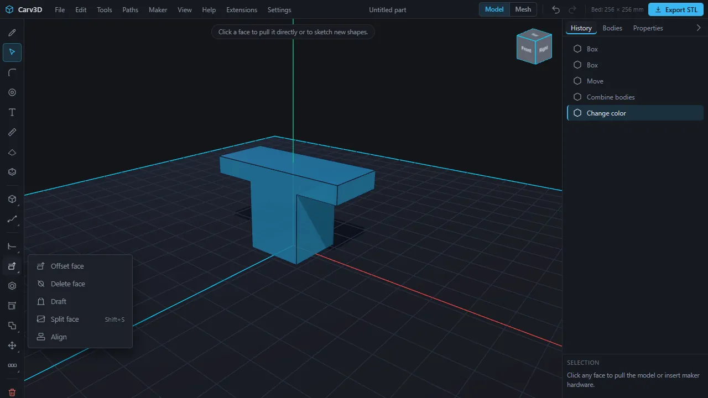

### 2.2 Moving the view

**Settings → Mouse controls** offers six templates. Pick the one you are used to; Carv3D remembers it in the browser. The mouse wheel always zooms. The switch **Zoom to cursor** in the same menu zooms toward the pointer instead of the screen center.

| Template (order in the list) | Orbit | Pan | Left button in empty space |
| --- | --- | --- | --- |
| 1. Default (as before) | left or right button | middle button | orbits the view |
| 2. Right button orbits | right button | middle button, or Shift + right | selects; drags a selection box |
| 3. Middle button orbits | middle button | Shift + middle | selects; drags a selection box |
| 4. Middle button orbits, Ctrl pans | middle button | Ctrl + middle | selects; drags a selection box |
| 5. Middle button pans | Shift + middle | middle button | selects; drags a selection box |
| 6. Trackpad / one hand | left button in empty space | right button | orbits the view |

The names of templates 2 to 5 in the menu recall common CAD and 3D programs; the table describes what each one does.

**Space** focuses on the selected face (and starts a sketch on a flat face). **Esc** deselects.

### 2.3 View cube and standard views

Click a side of the **view cube** (top right) to fly to that view. The same views are available as **View → Isometric / From top / From front / From right** and with the keyboard: **Ctrl + 1** isometric, **2** front, **3** back, **4** top, **5** bottom, **6** right, **7** left. The selection wheel has a **Views** ring as well.

### 2.4 Selecting

- **Click a face:** the whole face is highlighted and an arrow appears for pulling it. The Selection panel shows its size.
- **Click an edge:** the edge lights up and the bar **Modify Edge** appears. The end points of an edge can be grabbed too (see [5.9](#59-moving-an-edge-or-a-corner)).
- **Double-click a body:** selects the whole body. A handle next to it moves and rotates it, and the Selection panel offers **Resize**.
- **Click empty space** or press **Esc:** deselects.
- **M** shows or hides the dimensions of the body.

### 2.5 Several things at once

- **Shift + click** adds or removes faces or edges of the same body, or other bodies as a group. **Ctrl + A** selects all bodies.
- With several edges selected, rounding and chamfering act on all of them; with several faces selected, **Shell** opens all of them.
- A group of bodies has its own bar with **Join**, **Subtract**, **Intersect**, **Duplicate**, **Delete** and **Clear selection**. For **Subtract**, the body selected first is the one that is cut. The handle moves and rotates the whole group in one step. **Ctrl + C** and **Ctrl + V** copy and paste bodies, **Ctrl + D** duplicates them.
- **Selection box:** in templates where the left button is free in empty space (2 to 5), drag a box. Drawn **left to right** (solid, blue) it selects only what lies completely inside; drawn **right to left** (dashed, green) it selects everything it touches. **Tab** switches the filter between **Bodies** and **Faces** (the visible faces facing you); **Esc** cancels.

### 2.6 Context bar and selection wheel

The **context bar** at the top of the view always offers the actions that fit the selection:

| You selected | Actions |
| --- | --- |
| one face | Sketch, Maker hole, Shell, Offset face, Delete face, Draft, Split face, Align |
| several faces | Shell, Delete face, Draft |
| an edge | Fillet (Round), Chamfer (Bevel), Variable fillet, Unequal chamfer, Offset edge, From selected edges (creates a path) |
| a body | Scale, Mirror, Linear pattern, Pattern along path, Align, Split body, Duplicate, Delete |
| a group of bodies | Join, Subtract, Intersect, Duplicate, Delete |

Actions that do not fit (for example **Shell** on a curved face) are greyed out and show the reason when you point at them.

The **selection wheel** offers the same actions at the mouse pointer. Hold **Q**, move toward an entry and release; some entries open a second ring. Releasing in the middle or pressing **Esc** cancels; the keys **1** to **8** pick an entry directly. With nothing selected the wheel offers New box, New cylinder, Sketch, Select / Pull, Paths and Views; inside a sketch it offers the drawing tools; in mesh mode the brushes. In templates where the right button does not orbit, holding the right mouse button opens the wheel as well (switch this off under **Settings → Selection wheel: hold right mouse button**).

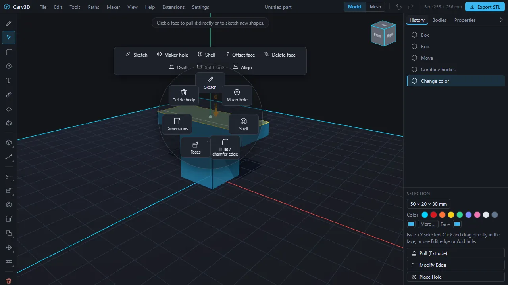

### 2.7 Typing exact values

Every number you can drag has a value badge. **Just type a number** (digits, decimal point or comma, minus) and the entry field opens; **Enter** confirms, **Esc** discards. **Tab** jumps to the next field. A negative value pushes a face into the body, a positive one pulls it out. Tool bars confirm with **Enter**, **Done**, or a click into empty space and discard with **Esc**.

### 2.8 Command search

**View → Command search …** (**Ctrl + K**) finds every menu command and tool while you type. It ignores case and umlauts and understands the beginnings and initial letters of words. Arrow keys choose, **Enter** runs, **Esc** closes. Recently used commands are listed first. Inside a sketch it finds the sketch tools as well.

### 2.9 Bodies, sketches and history

- **Bodies tab:** every body has an eye (show or hide), a name (double-click to rename) and **Show only this one**; **Show all again** brings the others back. Click a body to select it. Hidden bodies cannot be clicked and are not exported. Below, the **Sketches** list shows saved sketches with eye, rename, **Edit sketch** and **Delete sketch**.
- **History tab:** a list of every step you did (including steps done by an MCP client). It is a record; to go back use **Undo**.
- **Properties tab:** dimensions, volume, number of faces and edges of the selected body.

### 2.10 Undo and redo

**Edit → Undo** (**Ctrl + Z**) and **Edit → Redo** (**Ctrl + Y** or **Ctrl + Shift + Z**) work for every modeling step, including sketches, paths, colors and imports. The buttons at the top right do the same.

### 2.11 Changing keyboard shortcuts

**Settings → Key bindings …** lists every action with its keys. Click a field and press the new key or combination; **Backspace** clears the binding, **Esc** cancels, **+** adds a second key to the same action. If a key is already taken, Carv3D asks whether to swap. Keys the browser keeps for itself (such as Ctrl + W) cannot be used. **Reset** and **Reset all** restore the defaults; **Export** and **Import** save and load the bindings as a file. Tooltips and the shortcut list (**F1**) show your keys. The defaults are listed in [appendix A](#a-keyboard-shortcuts).

### 2.12 Language and other settings

**Settings** contains **Language** (Deutsch, English), **Mouse controls**, **Calculation method (cuts, holes)**, **Selection wheel: hold right mouse button** and **Key bindings …**. The calculation method chooses between **Automatic**, **Always exact** and **Always fast** (see [10.3](#103-exact-and-mesh-calculation)).

### 2.13 Learning aids

- **Help → Introduction …:** the guided tour (see [section 1](#1-quick-start)).
- **Help → User manual …:** the in-app manual with four complete example projects. **Load example project** replaces the open document after a confirmation, so save your work first.
- **Short "How it works" videos:** many tools show a play button in their tooltip; the video loops silently with subtitles in your interface language.
- **Help → Keyboard shortcuts …** (**F1**) shows the shortcut overview.

## 3. Creating bodies

### 3.1 Basic shapes

| Tool (tool rail, group of new shapes) | Result |
| --- | --- |
| **New box** (**R**, also **File → New box**) | box 50 × 50 × 15 mm |
| **New cylinder** (**C**, also **File → New cylinder**) | cylinder Ø 50 mm, 20 mm high |
| **New sphere** | sphere, radius 20 mm |
| **New ellipsoid** | stretched sphere with half axes 30, 18 and 22 mm |
| **New cone** | cone, base radius 20 mm, 40 mm high |
| **New ring (torus)** | ring, ring radius 25 mm, tube radius 7 mm |

The new body stands on the print bed at the origin. **Note:** it can overlap bodies that are already there; move it right after creating it. Set exact sizes with a double-click on the body and **Resize** ([5.10](#510-resize)). For round bodies (cylinder, sphere, cone, ring) Resize rebuilds the body with the new diameter.

### 3.2 Drawing a revolve

**Draw a revolve** (in the same group) opens a small drawing window: click points into the profile (the axis of rotation is on the left), drag points to move them, double-click a point to delete it. **Smooth curve through the points** rounds the profile. **Create** spins it into a vase, cup, bottle or dome. The tool **Revolve sketch** ([6](#6-paths-sweep-loft-and-revolve)) does the same from a saved sketch.

### 3.3 Helix and spring

- **Spring:** **Paths → Spring …** (**Shift + F**). Enter **Outer Ø**, **Wire Ø**, **Pitch**, **Turns**, round or square wire and the handedness, then **Create spring**. The spring stands on the print bed. The pitch must be larger than the wire diameter and the wire must leave a hole in the middle; otherwise a message explains what to change.
- **Helix** (a curve, not a solid): in the **Path** tool use **Helix:** with **Radius**, **Pitch**, **Turns** (up to 200), **Axis** (X, Y, Z, horizontal or vertical sketch axis, or a selected edge) and right-handed or left-handed, then **Create helix**. You can sweep a profile along it ([6](#6-paths-sweep-loft-and-revolve)).

### 3.4 Text

Select a flat face and choose **Engrave / emboss text** in the tool rail. In **Text on face** enter the **Text**, choose **Engrave (sunken)** or **Emboss (raised)**, and set **Size**, **Depth / height**, **Rotation** and the offsets **X** and **Y** in millimetres. The text is centered on the face. **Apply** builds real letters. Example: text "CARV", engrave, size 7, depth 0.8 mm. Text set flush into a pocket as a separate colored body ("inlay") is available through the command interface ([14](#14-ai-and-mcp)), not through this dialog.

## 4. Sketches

A sketch is a flat drawing on a plane or on a face. Closed shapes become **profiles** that you extrude into bodies or cut out. Sketches are saved in the project and stay editable.

### 4.1 Starting a sketch

1. Select a **flat face** (or nothing, to choose a plane next).
2. Choose **Sketch** (**S**; also in the context bar, or **Space** on a flat face).
3. Pick a plane when asked: **Top (XY)**, **Front (XZ)**, **Right (YZ)**, a flat model face, or a [construction plane](#49-construction-planes).

Sketching directly on a curved face is not possible; pick a flat face or a plane. The camera turns to look straight at the plane; **Face sketch** in the tool rail does that again after you moved the view. **Finish sketch** (**Esc**) leaves the sketch mode. The sketch is saved automatically as "Sketch 1", "Sketch 2" …

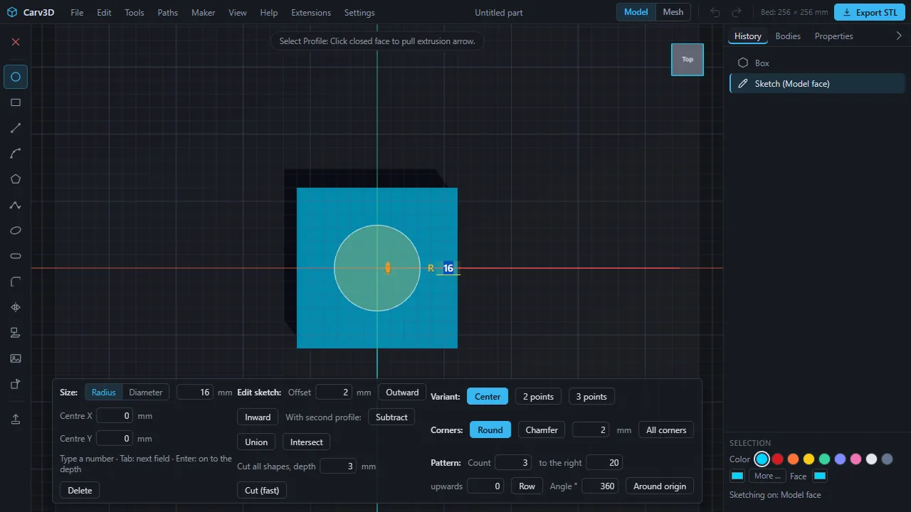

The bar at the bottom of the sketch has three columns: **Size:** (type values for the shape you are drawing), **Edit sketch:** (offset, combine, cut all) and, on the right, **Variant:**, **Corners:** (rounding) and **Pattern:** (repeat). They are explained in the next sections.

### 4.2 Drawing shapes

| Tool | Key | How it works |
| --- | --- | --- |
| **Circle** | **C** | click the center, drag the radius, click again. Press **C** again for variants: from 2 points (diameter) or from 3 points |
| **Rectangle** | **R** | click one corner, click the opposite corner. **R** again: from the center, or from 3 points |
| **Line** | **L** | click points; type a number for the exact length (**Tab**: angle). **Enter** finishes. Closed lines become a profile |
| **Arc** | **A** | in a line: click start, end, then a point that sets the bulge. **A** again returns to straight segments |
| **Polygon** | **P** | click the center, drag to the first corner and click; set the number of corners with arrow up/down or by typing |
| **Curve (spline)** | **S** | click points, the curve runs smoothly through them; **Enter** or a click on the first point closes it |
| **Ellipse** | **O** | click the center, drag out both half axes, click |
| **Slot** | **N** | click the centers of both ends, then the width; the ends become half circles |

For circles and rectangles the buttons **Variant:** in the sketch bar choose the variant as well (for a circle **Center**, **2 points**, **3 points**). Ellipses, arcs and slots stay exact. A shape inside another shape automatically becomes a **hole** of the outer one: a circle inside a rectangle extrudes into a plate with a hole. Remove the inner shape and the area is full again.

### 4.3 Typing sizes

While you draw, the part **Size:** of the sketch bar shows fields such as **Radius** (with a switch to **Diameter**), **Width**, **Height**, **Centre X** and **Centre Y**. Type a number, **Tab** moves to the next field, **Enter** continues to the depth, **Delete** removes the shape.

### 4.4 Rounding and chamfering corners

Choose **Round corners** (**F**) and click a corner; a click inside a face changes all its corners. In the bar choose **Round** or **Chamfer** (or **All corners**) and set the size. Messages explain when a corner cannot be rounded (the neighbouring edges are shorter than the size, a corner next to an arc, a shape with holes of its own).

### 4.5 Mirror and patterns

- **Mirror** (**M**): select a profile with the select tool, then click two points that define the mirror line. The mirrored copy is added next to the original.
- **Pattern:** with a profile selected, the bar **Pattern:** repeats it as a **Row** (count, step **to the right** and **upwards**) or **Around origin** (count and angle).

### 4.6 Project and reference image

- **Project** (**J**): click a face of a body; its outline and holes are laid perpendicular onto the sketch plane as shapes. This is how you build on existing geometry, for example a lid for a box. A face that stands perpendicular to the sketch plane would give only a line; a message explains that. Single edges cannot be projected yet.
- **Reference image:** places a photo or drawing semi-transparently under the sketch so you can trace it. Set **Width**, position, **Rotation** and **Opacity**; **Remove** takes it away. The image stays on your computer and disappears with the sketch.

### 4.7 Contour operations

The bar **Edit sketch:** works on the selected profile:

- **Offset**, **Outward** or **Inward**, by a distance you type (a wall thickness from an outline, for example). If the shape is too small for the offset, a message says so.
- **With second profile:** **Subtract**, **Union** or **Intersect**; then click the second profile in the sketch.
- **Cut all shapes, depth … → Cut (fast):** cuts every shape of the sketch into the body below in one step, even hundreds of holes within about a second. **Note:** the body becomes a mesh body afterwards (see [10](#10-mesh-mode)): smooth faces stay fine for printing, but fillets and thread holes are no longer possible on it.

### 4.8 Extruding and cutting

Click a closed area of the sketch (**Select profile**) and choose **Extrude** (**E**). Drag the arrow or type the distance. Carv3D decides what the result is and tells you in the status line:

- **New body** if the sketch does not lie on a body,
- **Add / Union** if you pull out of a body (the new part is joined with it),
- **Cut** if you push into it (negative distance).

**Beta behavior:** the profile is first pulled out by 20 mm, and a value you type is added to that (type −4 to end at 16 mm). Areas with holes extrude to bodies with holes. The sketch stays in the project after extruding.

### 4.9 Construction planes

A construction plane is a reference plane that does not belong to a body but carries sketches. **View → Construction plane …** (or the tool rail button) opens the bar **Construction plane:**

1. Choose the **Mode:** **Offset**, **Turn about u axis** or **Turn about v axis**.
2. Choose what it is made **from**: a base plane, the **Selected face** or an existing plane, and type the distance or angle.
3. **Create.** The plane appears as a violet surface. In the list **Existing** you can show or hide it, delete it, or press **Sketch on it**.

Planes are saved in the project and are part of undo.

## 5. Editing bodies

### 5.1 Pushing and pulling faces

1. Click a **flat face**. An orange arrow appears.
2. Drag the arrow, or type a number and press **Enter**. Positive pulls the face out (adds material), negative pushes it in (removes material).
3. While dragging, Carv3D snaps to nearby edges (a note says so; move the pointer away to release).

Pushing in also works on bodies with fillets, chamfers and slanted walls; the body is shortened there. If a second face lies in the same plane next to the one you pull (a split lid, two posts of equal height), only the face you clicked moves. **Pull (Extrude)** in the Selection panel starts the same action. Curved faces are changed by their radius instead (next section).

### 5.2 Changing the radius of round faces

Click the **wall of a hole**, the **outer wall of a post or cylinder**, or a **fillet**. The same orange arrow appears, with a label such as "R 19 · Ø 38 mm". Drag the arrow or type a value: the radius changes live. As with flat faces a positive value adds material: pulling into a hole makes it smaller, pulling away from it makes it larger; a post becomes thicker outward; an outside fillet becomes smaller. The smallest radius is 0.05 mm. On release one step **Face offset** is recorded. Cone surfaces, spheres and several faces at once cannot be changed this way yet.

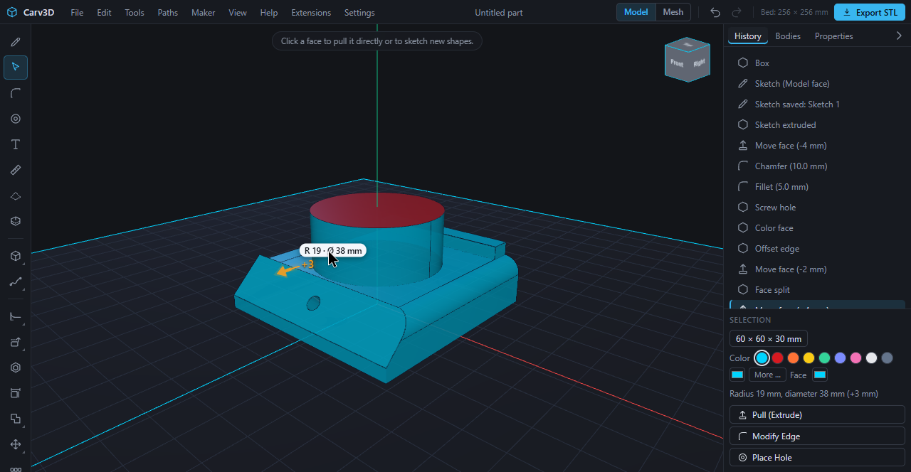

### 5.3 Rounding and chamfering edges

1. Click an edge (**F** switches to the edge tool; **Shift + click** adds more edges).
2. In the bar **Modify Edge:** choose **Fillet (Round)** or **Chamfer (Bevel)**. Pull the arrow outward to round or push it inward to chamfer, or type the value (radius or bevel width) and press **Enter**.
3. The edge is rounded or chamfered; **Undo** takes it back.

If the size does not fit, Carv3D reduces it and says so, or asks for a smaller value. Edges that are already round cannot be rounded again.

- **Variable fillet:** the radius grows or shrinks steadily from the start to the end of the edge. Enter **Radius start** and **Radius end**.
- **Unequal chamfer:** two sizes, one per face next to the edge. Enter **Size on first face** and **Size on second face** and choose which face is first (**Face A** or **Face B**).

Both are in the context bar and the selection wheel of an edge, with a short video.

### 5.4 Shell

Select a flat face (or several) and choose **Shell** (**H**). Enter the **Wall thickness**; the selected faces stay open and the body is hollowed out with an even wall. Example: a 90 × 60 × 28 mm box with 2.4 mm walls. If the wall is thicker than half the body, a message asks for a thinner wall.

### 5.5 Offset, delete and heal faces

- **Offset face** moves the selected face by a **Distance (+ material)**. On a hole, a post or a fillet it changes the radius (like [5.2](#52-changing-the-radius-of-round-faces)).
- **Delete face** removes a feature and heals the body: a **hole** is filled, a **post** is taken away, a **fillet** becomes a sharp edge again, and a **straight chamfer** between two flat faces becomes a sharp edge again. Select the wall of the feature and confirm with **Enter**.

Not every face can be healed. Pockets, chamfers at corners where several chamfers meet, and faces of cones or spheres are not supported; a message says so.

### 5.6 Offset edge

*Offset edge* draws a line on a face at a distance from an edge and splits the face along it. The body stays the same, but you get a new face that you can pull up or push in: a post that starts a few millimetres from the rim, or a recess with a border.

1. Click an edge (or select several edges that belong to the same face).
2. Choose **Offset edge** in the context bar.
3. The bar shows **Distance** and **Offset edge type**: **Chain** takes the whole connected chain of edges, **Single edge** only the one you picked. A blue line previews the split. Drag in the view to change the distance, or type it.
4. Confirm with **Done** (or **Enter**).

A positive distance runs onto the flat neighbouring face, a negative one onto the other face of the edge. Closed chains (a circular edge, the rim of a hole) give a closed line. Then click the new face and pull or push it, for example −2 mm for a recess.

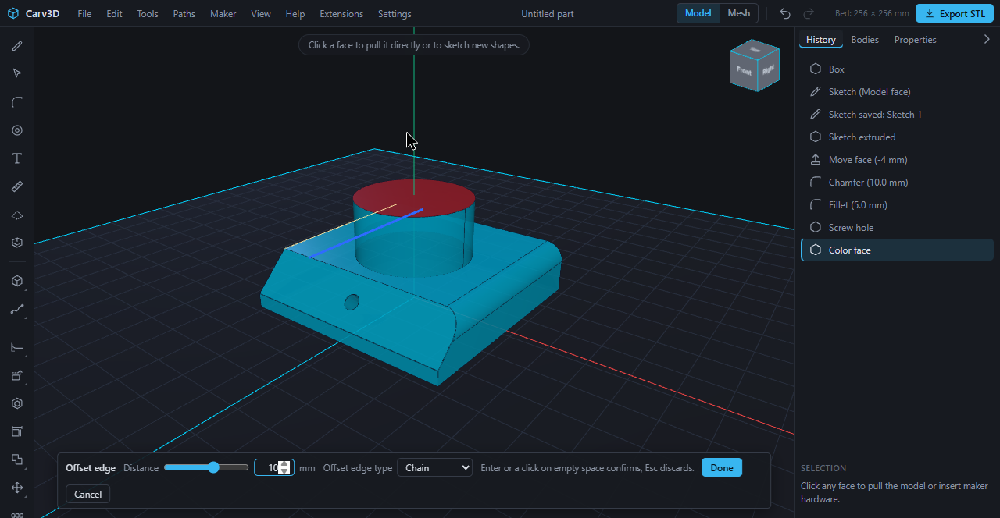

### 5.7 Split face

*Split face* cuts a flat face along a straight line without changing the shape of the body. Afterwards the smaller part is selected and can be pulled or pushed in at once (a rib, a step).

1. Select a flat face and choose **Split face** (context bar, selection wheel, tool rail or **Shift + S**).
2. Click the first point of the line. It snaps to corners and edge midpoints (a cross shows the snapped point).
3. Move the pointer: a blue preview line extends to the edge of the face and snaps to the direction of the edges and to right angles. Click the second point (or **Done** / **Enter**). **Esc** cancels.

Only flat faces and straight lines are supported.

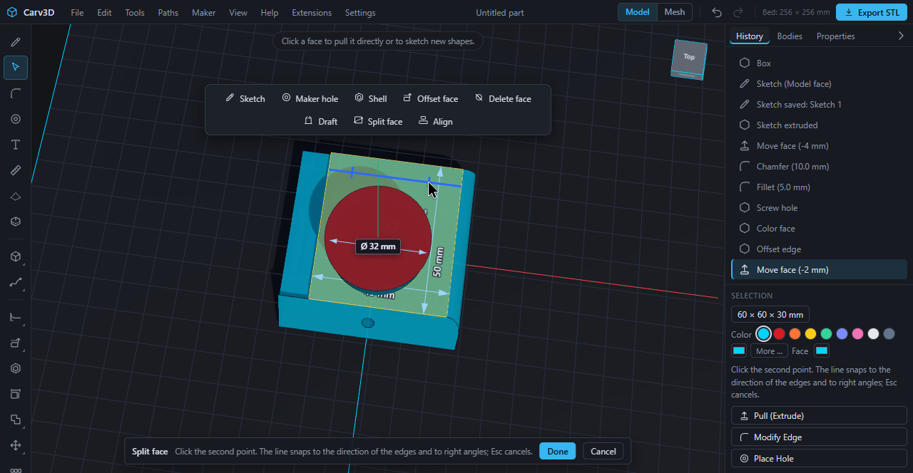

### 5.8 Draft

*Draft* tilts walls by an angle so that they become narrower or wider toward the top, which helps release from a mold and saves supports. Select the walls, choose **Draft**, enter the **Angle** (−30 to 30°) and the **Pull direction** (**Upwards** or **Downwards**). The bottom edge stays; the walls tilt from there. The angle is absolute: a wall that is already tilted is set to the entered angle, not tilted additionally; a note shows the existing tilt.

### 5.9 Moving an edge or a corner

Select an edge. In the edge bar **Move edge**, **Corner A** and **Corner B** appear. Choose one and drag the handle; **Esc** cancels. The neighbouring flat faces tilt along. This works only if all faces next to the edge are flat, without holes or fillets; otherwise a message says so. Round off edges after moving, not before.

### 5.10 Resize

Double-click a body and use **Resize**: type **Width (X)**, **Height (Y)** and **Depth (Z)** in millimetres. Fillets and neighbouring faces stay exact. Round bodies (cylinder, cone, sphere, ring) are rebuilt with the new diameter (width and depth must be equal); mesh bodies are stretched along the axes. A body that is tilted, domed or assembled and has no flat outer face in a direction cannot be set exactly; **Scale** works for it.

### 5.11 Move, rotate, scale, mirror, copy

- **Handle:** with a whole body selected, a handle stands next to it. Drag its parts to **move** or **rotate**; type a value for exact amounts. The switch **Copy** under the handle makes a copy instead of moving the original.
- **Move** (**G**): type X, Y and Z in millimetres.
- **Rotate** (**Shift + R**): choose the **Axis** (X, Y or Z) and the **Angle** (default 90°). The body turns around its center. **Note:** a body can sink below the print bed when turned; the printability check reports that.
- **Scale:** a **Factor** from 10 to 400 %. The body stays on the print bed.
- **Mirror** (**Shift + M**): select a flat face; the body is mirrored across it and both halves are joined.

### 5.12 Align

*Align* puts one body onto another. Select the body (for **Face to face** select a flat face of it), choose **Align** and pick the second body as **Tool body**. **Face to face** lays the selected flat face onto the best opposite flat face of the other body (the body turns if needed); **Gap** sets a distance. **Centre on centre** centers the body on the other.

### 5.13 Patterns

- **Linear pattern:** choose the **Axis**, the **Count** (2 to 20) and the **Spacing** in millimetres. The result is one body made of the original and its copies.
- **Circular pattern:** **Count** (2 to 36) and **Total angle**. The copies are distributed around the vertical axis through the origin.
- **Pattern along path:** see [6](#6-paths-sweep-loft-and-revolve).

### 5.14 Combining bodies

**Union** (**Ctrl + U**), **Subtract** (**Ctrl + B**) and **Intersect** (**Ctrl + I**) are guided: select the body to change, start the tool and click the second body; **Esc** or a click into empty space cancels. The second body is used up. The bodies must overlap. With a group selected, use the group bar ([2.5](#25-several-things-at-once)).

### 5.15 Splitting a body with alignment pins

**Maker → Split body …** cuts a body in two for printing, for example a part that is too big for the bed. Choose the direction (**Left/Right**, **Top/Bottom**, **Front/Back**), the **Position** of the cut and the number of **Alignment pins**; **Split**. The pins and the matching holes get clearance so that they fit when printed. Both parts lie next to each other, ready to print. If the cut face is too narrow for pins of that size, the body is split without pins and a note says so.

## 6. Paths, sweep, loft and revolve

The menu **Paths** (and the tool rail group) contains six tools that share one bar: **Draw path …** (**Shift + P**), **Sweep …** (**Shift + W**), **Revolve sketch …** (**Shift + D**), **Loft …** (**Shift + L**), **Pattern along path …** (**Shift + A**) and **Spring …** (**Shift + F**, see [3.3](#33-helix-and-spring)).

- **Path:** a 3D curve. Choose the **Type** (**Polyline** or **Smooth curve**, optionally **Closed**) and a working **Plane** (**Floor**, **Front**, **Side** or **Selected face**). Press **Draw** and click points; **Backspace** removes the last point; **Enter** or a double-click finishes. When you change the plane, the curve continues into the third direction: set the first points on the floor, then switch to **Front** to lift a point. A path can also be made **From selected edges** (edges that join end to end) or as a **helix**. Paths are shown in the view (start green, end red), saved in the project, and can be shown, hidden or deleted in the list **Paths**.
- **Sweep:** pulls a sketch face (**Profile**) along a **Path**: pipes, handles, rails. **End** tapers the profile toward the end (as a percentage), **Twist** turns it over the length. A hole in the profile stays open (hollow tube). The **Result** is a **New body**, or **Join with** or **Cut from** a body. **Run sweep.**
- **Revolve sketch:** turns a sketch face around an **Axis** (sketch horizontal or vertical axis, X, Y or Z axis, or a selected straight edge) by an **Angle** from 1 to 360°: rings, knobs, wheels, vases. As **Cut from** it makes a groove. A face that lies on both sides of the axis would pass through itself; a message explains.
- **Loft:** joins two to four sketch faces on different planes into one smooth body (a circle to a square, for example). Choose the **Sections** in order; **Smooth** or straight. Faces with holes cannot be lofted. **Run loft.**
- **Pattern along path:** repeats a body along a path by **Count** or by **Spacing (mm)**; **Turn with path** rotates the copies with the direction of the path. The body should stand at the start of the path. At most 200 copies. **Repeat.**

## 7. Fastening: holes, pockets and threads

The **Maker hole** tool (**Shift + H**; in the context bar, selection wheel or as **Place Hole** in the Selection panel) places fitted openings for screws, inserts, nuts and magnets.

1. Select the face where it should go (flat, slanted or curved) and start the tool. The bar **Maker Hardware:** appears.
2. Choose an entry from the list (below).
3. Move the pointer over the face: a preview follows and snaps to the surface. Click to fix the position.
4. On flat faces the fields **Center to edge** (← → ↑ ↓) show the distances to the nearest edges: type values to place the center exactly, or drag the preview with the mouse button held.
5. **Apply Cut** (or **Enter**) cuts the hole; **Cancel** discards it.

| Entry in the list | Sizes |
| --- | --- |
| **Screw through, socket head recessed** | M2, M2.5, M3, M4, M5, M6, M8 |
| **Screw through, countersunk head flush** | M2 to M8 |
| **Screw through, no head recess** | M2 to M8 |
| **Screw cuts its own thread into the plastic** | M2 to M8 (core hole) |
| **Model a thread (from M6)** | M6, M8, M10, M12, M14, M16, M20, M24, M30: a real internal thread; you enter the depth |
| **Heat-set insert (melt in)** | M2, M2.5, M3, M4, M5, M6 |
| **Nut pocket (hexagon)** and **Nut pocket with side slot** | M2 to M8 |
| **Magnet pocket (disc magnet)** | 5×2, 6×3, 8×3, 10×3, 10×5, 12×3, 15×3, 20×3 mm (diameter × height) |
| **Custom Hole (Ø / Depth)** | Ø 1 to 60 mm, depth 1 to 100 mm, fit **Press Fit (+0.05)**, **Standard (+0.20)** or **Loose (+0.35)** |

For all table entries, sizes and clearances come from maintained hardware tables and from **My printer** (fit allowance and shrinkage); the bar says so. Test-print once and adjust the fit allowance if screws jam or wobble.

**Slanted and curved faces.** On a face at any angle, or on a cone, cylinder or sphere, the tool points along the **surface normal at the spot you click**, not along an axis. Distances to the edge are measured on the real face outline (a warning appears if too little wall remains). A through hole reaches the inside of the first wall; on faces parallel to an axis it goes through the whole body. Pockets and the head recess get a **flat bottom** on curved faces; a note names the depth at the rim, and if the curvature is too strong the tool refuses and suggests a flatter spot, a greater depth or a smaller part.

**Limits.** A modeled internal thread needs a **flat face** (a slanted one is fine); on a curved wall use a self-tapping core hole or a heat-set insert. Typing distances to the edge works on flat faces only. A thread takes a few seconds to compute and makes the body heavier. If the place you chose contains no material (inside an existing hole or in the hollow of a shell), nothing is cut and a message says so.

Screw, nut and washer placeholder bodies, and threaded rods with a screw head, can be created with commands for assembly and collision checks ([14](#14-ai-and-mcp)); there is no tool button for them yet. A complete threaded pair is part of the example project [M10 bolt and internal thread](#m10-bolt-and-internal-thread).

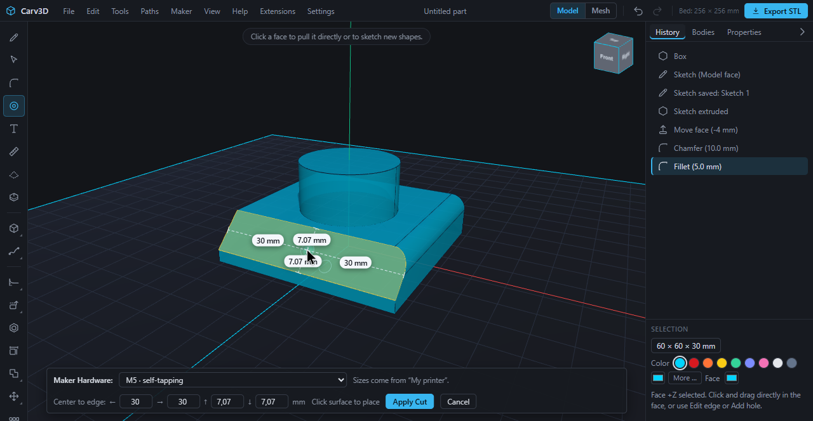

## 8. Colors and materials

- **Body color:** select a body; the Selection panel shows nine color swatches and a field for your own color. **More …** opens the full library.
- **Face color:** select a face; next to the swatches a swatch **Face** colors that face differently from the body. The **×** next to it removes the face color. The color belongs to the underlying surface, so it stays on the face through fillets, chamfers, holes, push/pull, move, rotate, mirror and scale, through undo, and in the project.
- **Colors & materials …** (**View** menu, or **More …**): a library with search. **Colors** has 24 colors; **Metal, gloss, silk, glass** has combinations such as metal silver, gold and copper, glossy red, silk blue and translucent clear. You can also enter any color as a hex value (for example `#d71920`). **Surface** chooses **Standard**, **Matt**, **Gloss**, **Metal**, **Silk** or **Translucent**. The surface only changes how the model looks on screen; **what is printed is the color.**
- **Save as appearance** stores the color and surface of the selected body under a name (saved with the project; it can be deleted again, and bodies keep their color when you delete it).
- **Print colors (plan):** the dialog groups your bodies and colored faces by color and estimates volume and filament in grams for each, using the material of your printer profile. Each line is one filament ("Filament 1: 12 g · 3 bodies"). A multi-color printer loads one filament per color; without such a system the color is display only.

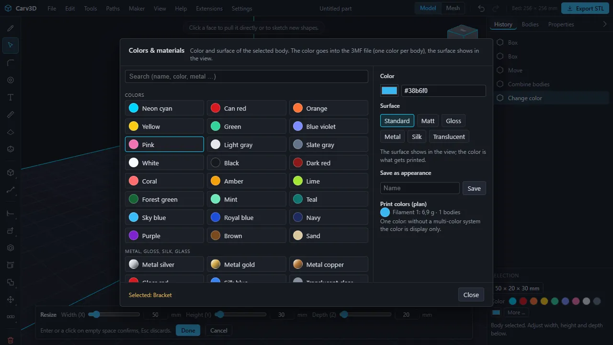

**3MF and slicers.** The 3MF export writes one color per body, a color per triangle for colored faces, and the body names as object names. For slicers of the same family (**Bambu Studio**, **OrcaSlicer**, **Anycubic Slicer Next**) it also writes the filament number per object, in the order of the color plan. The result was confirmed on screen in **Anycubic Slicer Next** (the slicer creates the filaments and takes over the colors). **Bambu Studio** and **OrcaSlicer** read the same file structure and **PrusaSlicer** reads the standard 3MF colors; we have not yet checked these three on screen. Check the colors in your slicer before a multi-color print.

**Limits.** Faces that lie in the same plane share one color, and a new face created in a colored plane takes over that color. Mesh bodies have no single faces and can only be colored as a whole. Colors are not read back from imported 3MF files.

## 9. Generators

**Maker → Generators …** opens a dialog with a list of ready-made parts. Enter a few dimensions, press **Create**, and the generator builds the bodies and lays them out on the print bed ready to print. **Defaults** resets the form. Wrong values give an explaining message and leave the dialog open.

**Box with lid.** A box with rounded corners, open at the top, and a lid with a plug that fits into the opening with clearance. Both are exact bodies. The lid lies beside the box (plate on the bed, plug up), so both parts print without supports. Optionally with a **Finger notch** in the front wall to pry the lid off and with **Dividers**.

| Setting | Default |
| --- | --- |
| Width (X) / Depth (Z) / Height (with lid) | 60 / 40 / 30 mm |
| Wall thickness / Floor thickness | 2 / 2 mm |
| Corner radius | 3 mm |
| Lid plate thickness / Plug height | 2 / 4 mm |
| Clearance per side | 0.2 mm |
| Finger notch | on |
| Dividers across X / across Z / Divider thickness | 0 / 0 / 1.2 mm |

**Woven lamp shade.** A cylinder whose wall is woven wire: two sets of slanted wires that pass over and under each other, a solid thread ring at the bottom for the lamp socket with light holes around it, and a woven lid that plugs on, lying beside it. Both parts are mesh bodies. The wires are steeper than 45° so that the shade prints without supports. You can set the diameter (default 46 mm), the height (default 50 mm with lid), the thread (default M36), the number, thickness and slope of the wires, the depth of the weave, the light holes, the lid clearance and the smoothness. Very dense or unsuitable values are refused with a hint; a smaller thread allows a narrower shade (the default thread needs about 46 mm). Creating takes a few seconds.

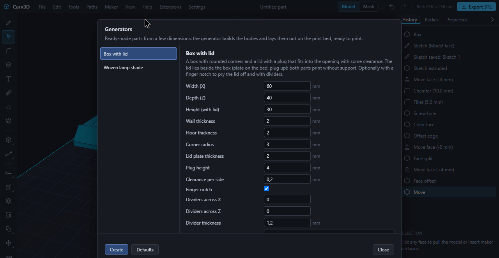

## 10. Mesh mode

Mesh mode shapes a body by hand like clay: for figures, grips and organic forms. The switch **Model | Mesh** in the top bar changes the mode.

### 10.1 Shaping with brushes

1. Double-click the body you want to shape and switch to **Mesh**. The body becomes a mesh body.
2. Pick a brush (keys **1** to **5**): **Grab** pulls the surface along with the mouse; **Inflate** pushes it outward (with **Ctrl** inward, a dent); **Smooth** evens out bumps; **Pinch** pulls the surface toward the brush center and sharpens creases; **Flatten** levels the surface under the brush.
3. Set **Radius** (keys **[** and **]**) and **Strength**. **Mirror (X)** makes the brush act symmetrically on the X plane, for symmetrical figures.
4. The left mouse button shapes, the right button turns the view. **Back** undoes the last stroke, **Done** keeps the result, **Cancel** discards it.

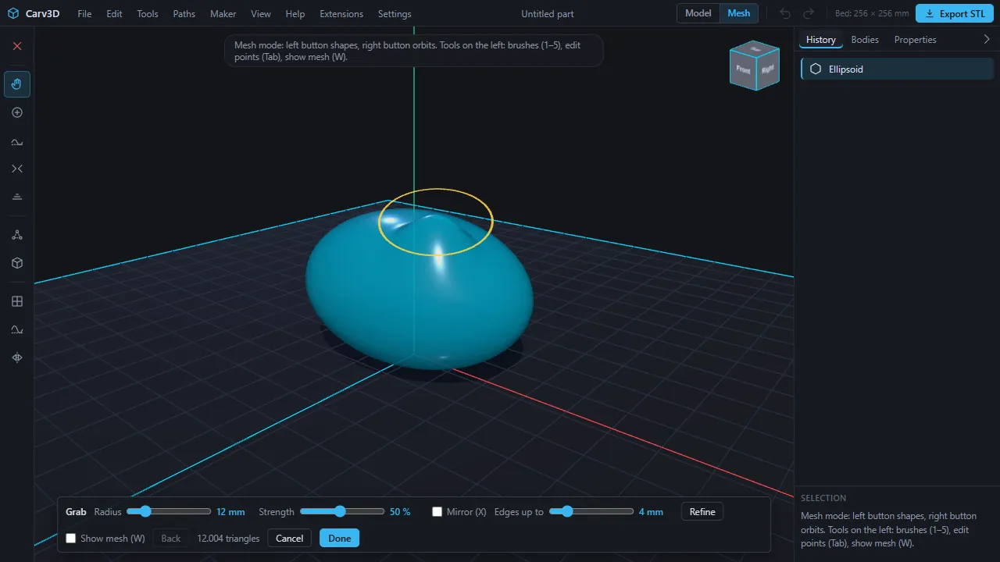

### 10.2 Points, refining and smoothing

- **Edit points** (**Tab**): the mesh is shown with points. Click points, select several with a selection box (**Shift** extends), then grab them: they follow the mouse. **X**, **Y**, **Z** lock the direction, **A** selects all points, **Alt + A** none; **Soft selection** moves neighbouring points along gently.
- **Show mesh** (**W**) shows the mesh lines so you see how fine it is.
- **Subdivide** splits every triangle into four. **Refine** splits only edges that are longer than **Edges up to … mm**, which adds detail where the mesh is coarse; with points selected it works only between them. **Smooth all** smooths the whole mesh a little.
- The mesh can have up to 250 000 triangles; the bar shows the count. Very strong strokes can tear the surface; the mesh must stay closed, otherwise a message asks for gentler strokes.

### 10.3 Exact and mesh calculation

Solid (exact) bodies and mesh bodies can live in the same project. Mesh bodies can be moved, rotated, scaled, colored, exported and shaped further; with the fast mesh engine they can also be combined with other bodies (union, subtract, intersect), patterned and drilled. Fillets, chamfers, shell and the face tools need an exact body (duplicate it before shaping if you want to keep an exact copy).

**Settings → Calculation method (cuts, holes)** chooses how cuts, holes, unions and patterns are computed:

- **Automatic** uses the fast mesh engine only for mesh bodies and for bodies with more than 150 faces; simple bodies stay exact. If a body is converted, a notice appears; **Undo** restores the exact body.
- **Always exact:** faces stay selectable, but dense bodies get slow.
- **Always fast:** bodies become mesh bodies without single faces.

## 11. Measuring and section view

- **Measure:** select a face, then **Shift + click** a second one. A dimension line appears in the view and the status line shows the distance (for parallel faces the perpendicular distance, otherwise the shortest distance) and the angle between the faces; touching faces say so. The button **Measure** and **View → Measure (two faces) …** explain it. The Selection panel and **M** show dimensions of the selection: lengths of straight edges, radius and diameter of round faces, area.
- **Section view:** the button **Section view** (or **View → Section view**) cuts all bodies open at a plane. In the bar choose the **Axis** (X, Y, Z), move the **Position** with the slider, **Show the other side** if needed, and **Close** to end. The cut face is shown filled. Selecting, measuring and tools keep working under the cut. It is a display only and does not change the model. Sketching ends the section view, and the print preview cannot be open at the same time.

## 12. Preparing for printing

### 12.1 My printer

**Maker → My printer …** stores your printer in the project: **Printer** (a list of printer profiles of common manufacturers, or **Custom printer**), **Material** (PLA, PETG, ABS, ASA, TPU 95A, PA6, PA12, PC, PLA-CF, PETG-CF, or **Custom material**), **Print bed width** and **depth**, **Maximum height**, **Nozzle**, **Layer height**, **Shrinkage** and **Fit allowance**. Holes are drawn larger by the shrinkage (leave it at 0 if unsure). The fit allowance is extra clearance for holes; 0.2 mm usually fits. Shrinkage is an experience value, not a manufacturer figure: check fits with a test print.

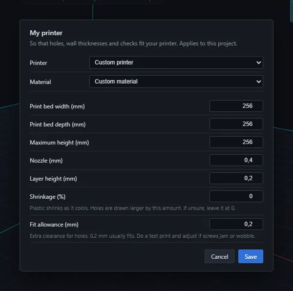

### 12.2 Check printability

**Maker → Check printability …** checks all bodies against your printer profile and explains each finding in plain words, often with a **Fix it** button:

- the part fits the **bed** (width, depth, height) and does not reach below it,
- the part does not **float** above the bed,
- **walls** are not thinner than your nozzle can print,
- **overhangs** (surfaces that lean out so much that they need support) and **bridges** (horizontal ceilings spanning a gap).

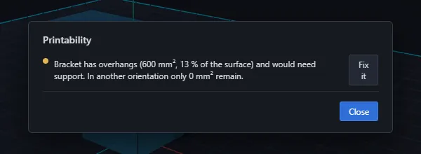

### 12.3 Print preview and orientation

**Maker → Print preview …** shows the parts as they would print. The slider **Layer** steps through the layers (layer number and height), **Show overhangs** colors the problem areas, and the line below gives the estimated filament weight and length, the overhang share and the number of bridges with the longest span. **Best orientation** turns the parts so that as little support as possible is needed (the preview says if the current orientation is already the best). Parts that are too big can be split with [5.15](#515-splitting-a-body-with-alignment-pins).

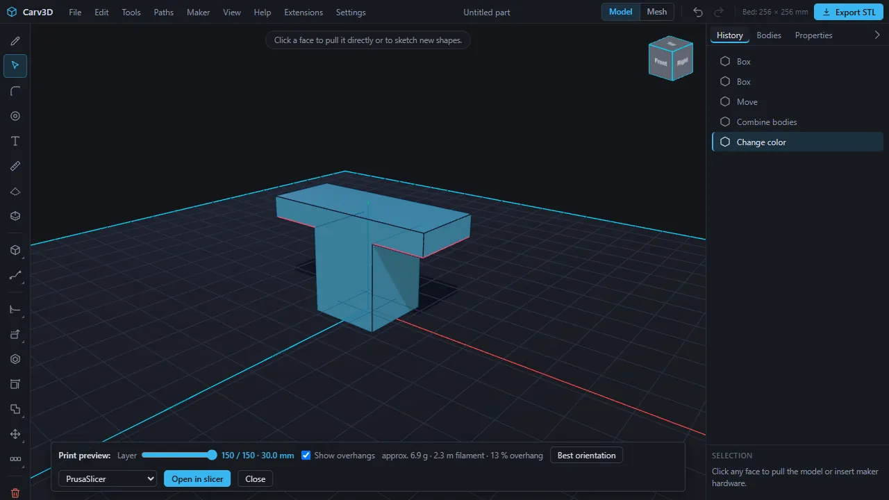

### 12.4 Handing over to the slicer

In the print preview choose a slicer and press **Open in slicer**: the parts are handed over as 3MF to **PrusaSlicer**, **OrcaSlicer**, **Bambu Studio** or **Anycubic Slicer Next**. **Save as file only** saves the 3MF instead. The file goes over your own computer only. This works with the start script of the beta package (keep its window open), which passes the file to the slicer. If the slicer does not open (it is not set up for this link, or Carv3D runs without the start script), the file is saved instead; drag it into the slicer or open it there. Anycubic Slicer Next is started by the start script from its installation folder if it is installed there.

## 13. Files: projects, import and export

### 13.1 Projects

- **File → Save project** writes an editable `.carv` file with exact geometry, body names, colors, sketches, paths, construction planes, appearances and the printer profile. Your browser stores the file in its download folder.
- **File → Open project …** opens a `.carv` file; so does dragging it onto the window. Opening replaces the current document. Older project files keep opening in newer versions; a project from a newer version asks you to update the app.
- **Keep the `.carv` file** even after exporting: mesh exports are not editable masters.

### 13.2 Automatic backup and recovery

Carv3D saves your work automatically in the browser's storage. After a crash or an accidentally closed tab, the next start asks **Restore your work?** with the time and the number of bodies; **Restore** continues there, **Start fresh** begins anew. The automatic backup lives only in this browser: it does not replace saving your project as a file.

### 13.3 Import

**File → Import model (STL, OBJ, 3MF, STEP, SVG, DXF) …**, or drag a file onto the window:

| Format | What you get |
| --- | --- |
| **STEP** (`.step`, `.stp`) | every solid becomes an exact body (holes and fillets stay smooth), units are converted to mm, up to 50 bodies |
| **STL**, **OBJ** | a closed mesh becomes a body you can drill, round and combine; up to 60 000 triangles per part |
| **3MF** | every part on the plate becomes its own body with its position and unit; same limit |
| **DXF** (ASCII) | a **sketch** on the base plane: circles, ellipses and lines or arcs that join into closed outlines; shapes inside shapes become holes; units from the file. Open lines, splines, text and blocks are counted and reported, not imported |
| **SVG** | the filled shapes are extruded into a body, 3 mm high and 60 mm wide, centered on the bed; shapes inside shapes become holes; outlines without fill are ignored |

Meshes must be closed. An open or faulty mesh is refused with a hint (repair it in your slicer first); dense meshes take a long time to read.

### 13.4 Export

**File → Export as STL …**, **Export as 3MF …**, **Export as STEP …** (and the **Export STL** button) write all **visible** bodies.

- **3MF** is the preferred format for current slicers: millimetres, Z up, with colors and body names.
- **STL** (binary, Z up) is the most widely understood format.
- **STEP** carries exact solid geometry to other CAD systems; mesh bodies cannot be exported as STEP.

After your test period ends (30 days from your first start; for personally invited early testers 31 March 2027), existing projects can still be opened, saved and exported.

## 14. AI and MCP

Every function of Carv3D is a command, and the same commands drive the interface, the tests and the **local MCP server** that stereodruid developed. An MCP-capable assistant on your computer can therefore model with you or for you. There is **no cloud provider built into Carv3D**: you do not enter an API key into the program, the geometry stays on your machine, and which tools you connect is your choice. The server can run **headless** (without the interface) or connect to the **open Carv3D window**, where you see every step appear and undo it as usual. **Help → Introduction …** shows a ready-made configuration block for your assistant; the installation guide of the beta package describes the setup.

What the commands cover, in one sentence per area:

- **Reading:** document, bodies, selection, faces and edges, measurements between faces and edges.
- **Creating:** boxes, cylinders, spheres, ellipsoids, cones, rings, revolves, lofts, sweeps, text, SVG and DXF import, helices, springs, paths.
- **Editing:** push/pull, offset and delete faces, split face, offset edge, fillets and chamfers, shell, draft, align, resize, move edges and corners.
- **Transforming and combining:** move, rotate, scale, mirror, duplicate, linear, circular and path patterns, union, subtract, intersect, splitting with pins.
- **Sketches and planes:** create sketches and construction planes, add shapes, round corners, mirror, pattern, project faces, extrude and cut.
- **Fastening:** screw holes, nut, magnet and insert pockets, threads, screw, nut and washer placeholder bodies, the table of hardware.
- **Colors:** body and face colors, appearances, palette, color plan.
- **Generators:** box with lid, woven lamp shade.
- **Printing:** printer profile, printability check, overhang analysis, best orientation, splitting.
- **Files:** import, export (STL, 3MF, STEP), save and load projects, undo and redo, the calculation method.

The public repository does not contain the MCP documentation; the beta package describes the commands.

## 15. Extensions

Carv3D is preparing a **controlled extension interface**; the application core stays closed. Official community extensions will be free of charge, their source code publicly visible, and every extension declares its permissions. New extensions and updates pass automated and manual review, and published packages are built from the reviewed source.

In this beta the menu **Extensions → Manage extensions …** exists: it shows installed extensions, their commands and permissions (read the document, create and change bodies and sketches, create files) and lets you install, switch off or remove one. **Install only extensions from sources you trust**; every step an extension performs appears in the history and can be undone. **There is no official extension directory yet and public submissions are not accepted yet.** Package validation, signatures, restricted permissions and a safe update path must be ready first. See [Extensions and community contributions](EXTENSIONS.md).

## 16. Learning paths and examples

Work through these in order if you are new. The first four examples are complete projects under **Help → User manual …**.

### Angle bracket with countersunk holes

A practical mounting part that demonstrates:

- boxes and exact dimensions
- 2 mm edge fillets
- two table-driven M4 countersunk holes
- Boolean union into one printable solid

Suggested exercise: change the flange height, move the holes by their edge distances, then export the bracket as 3MF.

### Electronics enclosure with lid

A two-body project consisting of an open enclosure and removable lid. It demonstrates:

- shelling a 90 × 60 × 28 mm box to 2.4 mm walls
- separate bodies and visibility control
- four internal bosses with M3 heat-set insert pockets
- four M3 socket-head holes in the lid

Suggested exercise: resize the enclosure, move one boss and create a cable opening in a side wall.

### Control knob with D-shaft socket

A compact example of more advanced shape construction:

- revolved profile for the main knob
- circular pattern with sixteen grip grooves
- Boolean subtraction
- extruded polygon for the keyed shaft socket

Suggested exercise: change the groove count or shaft dimensions and run the printability check.

### M10 bolt and internal thread

A functional two-body threaded pair:

- modeled M10 external thread on a hex bolt
- matching M10 internal thread in a separate block
- 1.5 mm ISO coarse pitch
- 0.25 mm radial fit clearance for 3D printing

Suggested exercise: create another thread with the hole tool and tune fit clearance for your printer. Heat-set inserts are usually more reliable below M6.

### Saving and export

- **`.carv`** preserves editable exact geometry, body names, colors, sketches and the print profile.
- **3MF** is the preferred format for modern slicers.
- **STL** is suitable for broad compatibility.
- **STEP** transfers exact solid geometry to another CAD system.

Keep the `.carv` project even after exporting, because mesh exports are not intended as the editable master file.

### From a box to a printable part (the film, step by step)

The [introduction film](../README.md) was recorded in the real application with exactly these steps. Doing them yourself touches most of the newer tools.

1. **Base.** **File → New box**, double-click it, **Resize** to Width 60, Height 14, Depth 60 mm.
2. **Post.** Click the top face, **Sketch**, choose **Circle**, click the center of the face and drag out a radius of 16 mm (Ø 32). **Extrude** and type −4: the post ends up 16 mm tall.
3. **Chamfer and fillet.** Click the front top edge, **Chamfer (Bevel)**, type 10. Click the right top edge, **Fillet (Round)**, type 5.
4. **Screw on the slanted face.** Click the chamfer face, start **Maker hole**, choose **Screw cuts its own thread into the plastic** with M5, move to the face, click, **Apply Cut**.
5. **Color.** Click the top face of the post and choose a red in the swatch **Face**.
6. **Offset edge.** Click the left top edge, **Offset edge**, distance 10 mm, **Done**. Click the new strip and type −2 to press it in.
7. **Split face.** Look from above (**Ctrl + 4**), click the top face of the base behind the post, **Split face**, click two points for a line, then pull the smaller part by 4 mm: a rib appears.
8. **Radius.** Click the wall of the post and drag the arrow: the radius changes (R and Ø are shown).
9. **Generator.** Move the part aside, open **Maker → Generators …**, choose **Box with lid**, **Create**.
10. **Export.** **File → Export as 3MF …**. The colors go into the file.

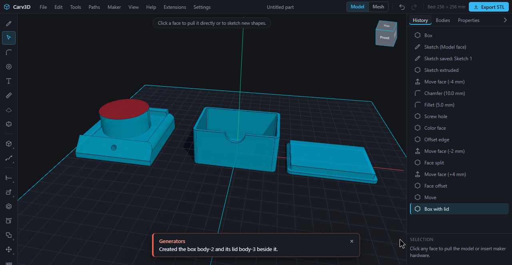

## 17. Known limits

Carv3D is in early beta. The current focus is direct modeling and parts for 3D printing.

**General**

- Operation and the project format may still change during the 0.x phase. Editing is time limited: 30 days from your first start (extendable on request), for personally invited early testers through 31 March 2027; opening, saving and export remain available afterwards. **Help → About Carv3D …** shows the remaining days.
- Data loss cannot be excluded. Save `.carv` files and keep an extra copy in an exchange format such as STEP or 3MF; the automatic backup lives only in the browser.
- Very large or geometrically complex models can be slow or fail. If the geometry kernel crashes, it is restarted and the body is restored (the history is reset). Tablet and touch operation are not fully optimized, and there is no installer yet (a package with a start script).
- New bodies from the menu appear at the origin and can overlap existing ones. After extruding a sketch, a typed value is added to the current height.

**Modeling**

- Sketches: no sketching on curved faces; no trim and extend; no dimension constraints (parallel, tangent, equal …); single edges cannot be projected; no construction axes or points.
- Push/pull works on flat faces; the radius can be changed on holes, posts, cylinders and fillets, but not on cone surfaces and spheres, and not for several faces at once.
- Delete face heals holes, posts, fillets (cylindrical faces) and straight chamfers between two flat faces, not pockets or corner chamfers. Split face works on flat faces with straight lines. Offset edge works on flat faces; open chains are extended straight to the rim of the face. Replacing a face is not available.
- Moving edges and corners needs flat neighbouring faces without holes and fillets. The draft angle is absolute and the neutral plane is the bottom of the body.
- Paths have no arcs yet (polyline or smooth curve only); a loft has no guide curves and does not take faces with holes. Paths with very many points can fail.
- A modeled thread needs a flat face and takes seconds; without a given depth it is limited to 40 turns. Holes on curved faces measure the rim as a projection, which is an approximation.
- Mesh bodies have no single faces or edges: no fillets, shell, face tools, face colors or STEP export. Importing or processing dense meshes can take minutes; resizing a rounded box to a tiny width can leave a remnant; filleting an edge of an imported faceted body can report a wrong volume.

**Files and printing**

- Import needs closed meshes up to 60 000 triangles per part; STEP files of a torus cannot be re-imported yet; DXF files must be ASCII; DXF export is not available; colors of imported 3MF files are not read.
- The slicer hand-over needs the start script of the beta package; without it the 3MF is saved as a file. Multi-color 3MF output has been confirmed on screen in Anycubic Slicer Next only (see [8](#8-colors-and-materials)).
- Placeholder screws, nuts, washers and threaded rods exist as commands only, not as tool buttons.

Further known issues are listed in [Known limitations](KNOWN_LIMITATIONS.md) and in GitHub Issues.

## 18. Help and feedback

- **In the program:** **Help → Send feedback …** opens a form for a bug, an idea or a question. Nothing is sent automatically: you see exactly what would go along (optionally version, browser and the latest errors, never your models) and send it yourself, by copying it, by e-mail or as a report on GitHub.
- **E-mail:** beta@carv3d.de.
- **GitHub:** [Report a bug](https://github.com/Carv3D-Studio/Carv3D/issues/new?template=bug_report.yml) · [Request a feature](https://github.com/Carv3D-Studio/Carv3D/issues/new?template=feature_request.yml). A good report describes the shortest path that reproduces the problem and includes the version (**Help → About Carv3D …**), the system and the browser. Attach project files only if they contain nothing confidential.
- **Security problems** are not reported in public issues; see [SECURITY.md](../SECURITY.md).
- More: [Beta testing guide](BETA_TESTING.md) · [Current capabilities](CAPABILITIES.md) · [Public roadmap](../ROADMAP.md).

## A. Keyboard shortcuts

You can change every key under **Settings → Key bindings …** ([2.11](#211-changing-keyboard-shortcuts)). **Ctrl** also means the Command key on a Mac.

| Area | Key | Action |
| --- | --- | --- |
| View | mouse wheel | zoom |
| | **Space** | focus the face / start a sketch |
| | **Ctrl + 1** … **7** | isometric, front, back, top, bottom, right, left |
| | **Ctrl + K** | command search |
| | **F1** | keyboard shortcuts |
| | **Q** (hold) | selection wheel |
| | **M** | show or hide dimensions |
| Edit | **Ctrl + Z** | undo |
| | **Ctrl + Y** or **Ctrl + Shift + Z** | redo |
| | **Ctrl + C** / **V** / **D** / **A** | copy, paste, duplicate, select all bodies |
| | **Delete** or **Backspace** | delete body |
| | **Esc** | deselect or cancel |
| | **Enter** | confirm |
| Modes | **V** | Select / Pull |
| | **S** | Sketch |
| | **F** | Fillet / chamfer edge |
| | **Shift + H** | Maker hole |
| | **R** / **C** | New box / New cylinder |
| | **Shift + P** / **W** / **D** / **L** / **A** / **F** | Path / Sweep / Revolve sketch / Loft / Pattern along path / Spring |
| Tools | **H** | Shell |
| | **Shift + S** | Split face |
| | **G** | Move |
| | **Shift + R** | Rotate |
| | **Shift + M** | Mirror |
| | **Ctrl + U** / **B** / **I** | Union / Subtract / Intersect |
| Sketch | **C** / **R** / **L** / **S** / **P** / **A** | Circle / Rectangle / Line / Curve / Polygon / Arc |
| | **O** / **N** | Ellipse / Slot |
| | **F** / **M** / **J** | Round corners / Mirror / Project |
| | **E** | Extrude |
| | **Enter** | finish a line |
| | **Esc** | finish sketch |
| Mesh mode | **1** … **5** | brushes: Grab, Inflate, Smooth, Pinch, Flatten |
| | **[** / **]** | brush smaller / larger |
| | **Tab** | edit points on or off |
| | **W** | show mesh |
| | **A** / **Alt + A** | select all points / none |
| | **X** / **Y** / **Z** | lock the axis |

## B. Glossary

- **Body:** one solid object in your project. A project can contain many.
- **Face, edge, corner:** the flat or curved surfaces of a body, the lines where faces meet, and the points where edges meet.
- **Solid (exact) body:** a body with exact surfaces (a round hole is truly round), so that it can be rounded, drilled and exported as STEP. Opposite: a **mesh body** made of many small triangles, as used for shaping by hand.
- **Sketch and profile:** a flat drawing; a closed area in it is a profile that can be extruded.
- **Extrude:** pull a flat shape into a body, or push it in to cut.
- **Fillet and chamfer:** a rounded edge and a bevelled edge.
- **Shell:** hollow out a body to a given wall thickness.
- **Boolean operation:** combine bodies by union, subtraction or intersection.
- **Overhang and bridge:** a part of the model that leans out so much that the printer needs support under it; a horizontal ceiling that spans a gap.
- **Slicer:** the program that turns your model into instructions for the printer.
- **3MF, STL, STEP:** file formats. 3MF and STL are meshes for slicers (3MF can carry colors); STEP carries exact solids for CAD programs.
- **Nozzle, layer height, fit allowance:** the opening of the print nozzle; the thickness of one printed layer; the extra clearance added to holes so that parts fit.
- **Heat-set insert:** a small metal thread part that is melted into the plastic.
- **MCP:** a standard way for an assistant program to use another program's commands; here always on your own computer.
